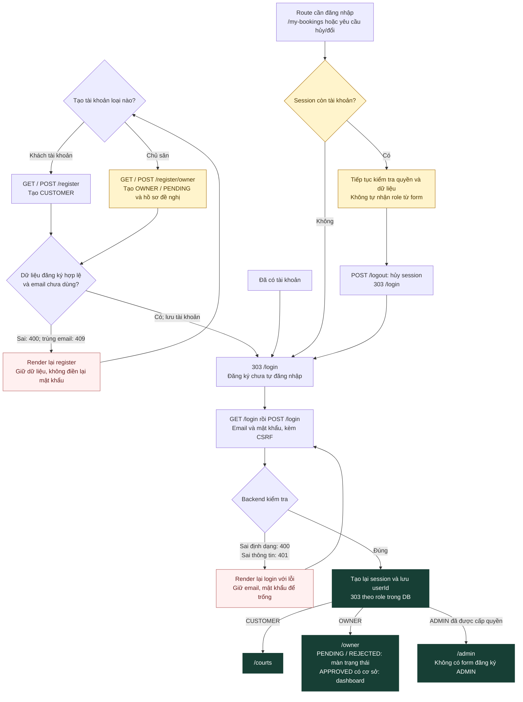
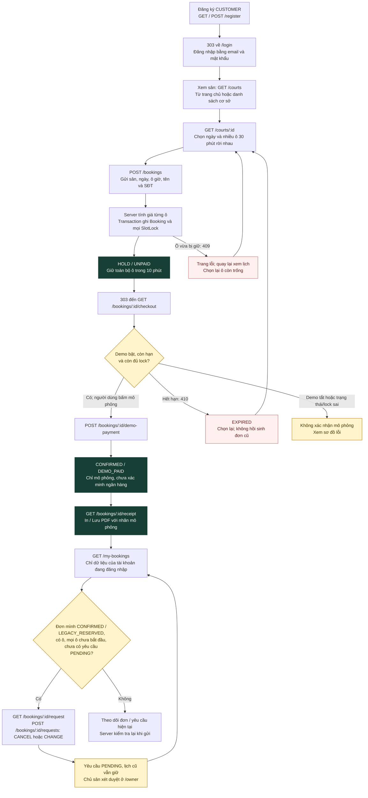
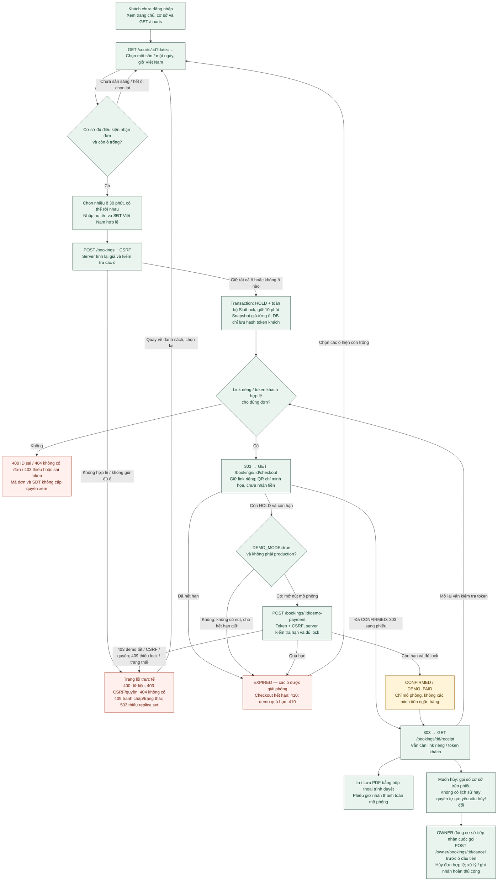
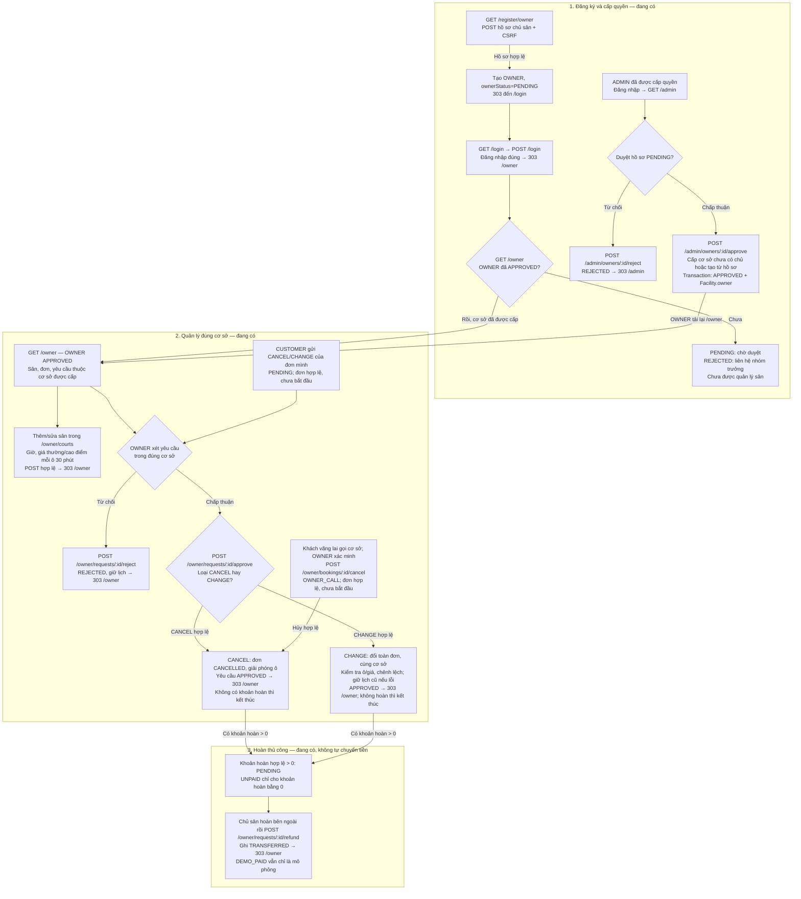
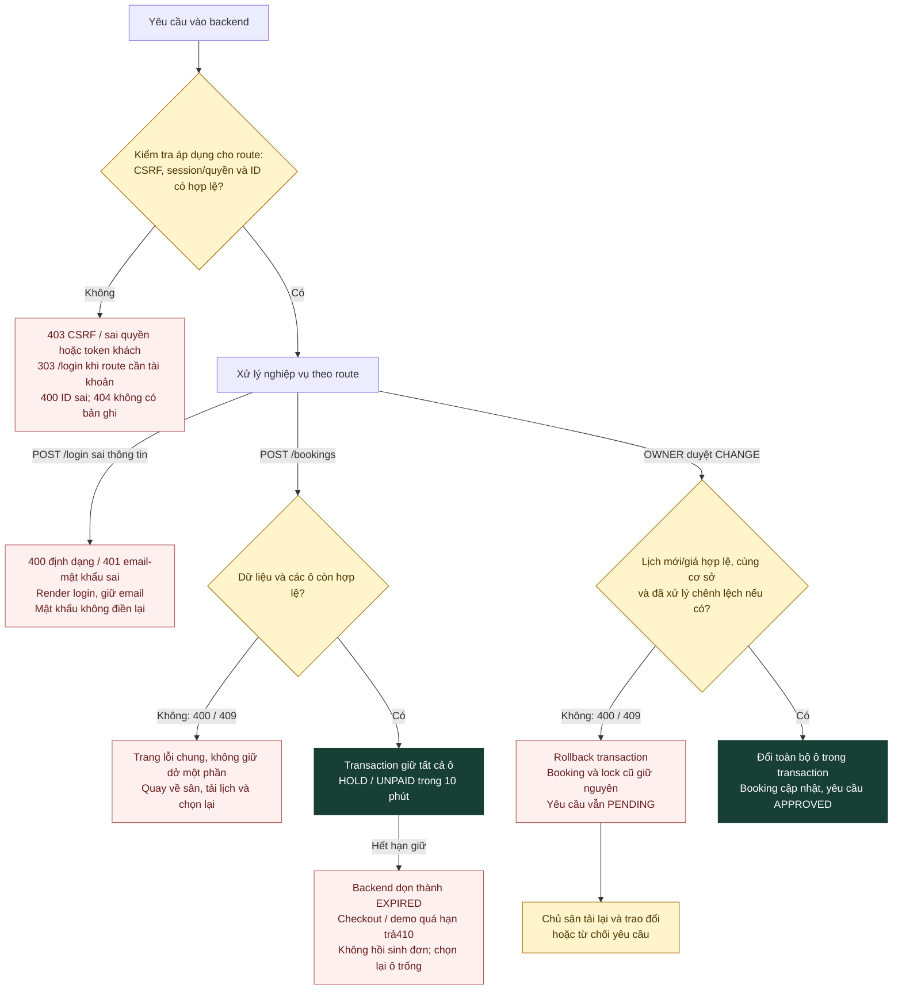

# Sơ đồ luồng đăng ký, đặt sân và chủ sân

Đối chiếu ngày **23/10/2026**, trên `main` tại SHA [`7d612bc00ba0fbda8efab3ba0c02ddf0ab73ee69`](https://github.com/indominusrex932005-arch/dat-san-tu-dau/tree/7d612bc00ba0fbda8efab3ba0c02ddf0ab73ee69), sau khi tích hợp PR #26, #27, #28. Tài liệu phục vụ [issue #31](https://github.com/indominusrex932005-arch/dat-san-tu-dau/issues/31); các sơ đồ mô tả hành vi đã có ở SHA này. PR chưa merge không được tính vào bản đối chiếu.

**Lưu ý cập nhật 24/10/2026 — issue #37:** các sơ đồ và lời trình bày bên dưới giữ nguyên bản đối chiếu 23/10/2026. Cụm “giữ 10 phút” ở bản lịch sử này đã được thay bằng **“tối đa 10 phút, trước khi ô đầu tiên bắt đầu”** trong cập nhật #37; không dùng sơ đồ cũ để hiểu rằng được giữ sau giờ sân bắt đầu. Xem quy tắc hiện hành tại mục 11.

## 1. Cách đọc và dữ liệu chung

- **Facility / cơ sở** là địa điểm kinh doanh: tên, địa chỉ, SĐT và OWNER được cấp. **Court / sân** là từng sân trong cơ sở, có giờ hoạt động, giá thường/cao điểm và trạng thái nhận đặt. Một cơ sở có nhiều sân; mỗi OWNER được cấp một cơ sở.
- Một Booking thuộc **một sân, một ngày**, gồm từ 1 đến 48 ô **30 phút**, có thể rời nhau. Giờ hiển thị theo Việt Nam; server tính và lưu giá từng ô, tổng tiền, không lấy giá cuối từ form khách gửi.
- Danh sách `/courts` hiển thị các sân active cùng thông tin cơ sở. Chọn một sân rồi chọn ngày trên `/courts/:id`; không coi danh sách cơ sở là danh sách từng sân.
- Mũi tên là bước chuyển hoặc kết quả xử lý đã có. Tên trạng thái luôn viết bằng chữ; màu chỉ hỗ trợ đọc. `PENDING` của hồ sơ OWNER/yêu cầu hủy đổi khác `HOLD` của Booking.
- Mermaid trong tài liệu được đồng bộ với năm tệp [`luong-su-dung/*.mmd`](luong-su-dung/). GitHub hiển thị sơ đồ từ khối Mermaid; tệp nguồn vẫn sửa được.

**Thanh toán hiện tại chỉ là mô phỏng.** `DEMO_PAID` và phiếu mô phỏng chưa chứng minh tiền đã về ngân hàng. QR minh họa không dùng để chuyển khoản; nguồn giải thích chính thức là [THANH_TOAN_CON_DANG_DO.md](THANH_TOAN_CON_DANG_DO.md).

## 2. Đăng ký, đăng nhập và điểm đến theo vai trò

Nguồn chỉnh sửa: [dang-nhap.mmd](luong-su-dung/dang-nhap.mmd).

Đăng ký khách tạo CUSTOMER; đăng ký chủ sân tạo OWNER/PENDING. Cả hai khi thành công đều về `/login`, chưa tự đăng nhập. ADMIN được cấp bằng quy trình quản trị trong [hướng dẫn tích hợp](HUONG_DAN_TICH_HOP.md), không có lựa chọn đăng ký ADMIN qua form.

Đăng nhập đúng tạo lại session và điều hướng theo role trong DB: CUSTOMER đến `/courts`, OWNER đến `/owner`, ADMIN đến `/admin`. Đăng nhập sai định dạng trả 400, sai thông tin trả 401; form giữ email và không điền lại mật khẩu. Route bảo vệ chuyển người chưa đăng nhập đến `/login`; không có cơ chế tự gửi lại đơn hoặc tự quay về một form đặt cũ sau login.

## 3. Khách có tài khoản: giữ sân, phiếu và yêu cầu hủy/đổi

Nguồn chỉnh sửa: [luong-chinh.mmd](luong-su-dung/luong-chinh.mmd).

Khách nhập/chọn sân, ngày, các ô và thông tin liên hệ. Server kiểm tra sân active, cơ sở có OWNER APPROVED và SĐT hợp lệ, thời điểm và lịch trống. Trong transaction, server ghi Booking cùng **toàn bộ** SlotLock; xung đột thì không giữ dở một phần. Mỗi ô có snapshot giá thường/cao điểm; các ô ở giữa hai lựa chọn rời nhau không bị giữ.

Sau khi giữ thành công, Booking là `HOLD/UNPAID`, hạn giữ tính bằng 10 phút từ lúc server xử lý. Nút mô phỏng chỉ mở khi `DEMO_MODE=true` và không chạy production. Server kiểm tra quyền xem, hạn và đủ lock lần nữa trước khi ghi `CONFIRMED/DEMO_PAID`; phiếu giữ nhãn mô phỏng. In/Lưu PDF mở hộp thoại in của trình duyệt, người dùng chọn lưu PDF.

`GET /my-bookings` lọc theo `Booking.user` của người đăng nhập, bao gồm yêu cầu và khoản hoàn/chênh lệch đã ghi. Gửi CANCEL/CHANGE chỉ được với **đơn của mình**, trạng thái `CONFIRMED` hoặc `LEGACY_RESERVED`, có ô và mọi ô chưa bắt đầu, không có yêu cầu PENDING khác. Backend kiểm tra khi POST; việc mở được form không tự bảo đảm gửi thành công.

Gửi CHANGE chỉ tạo yêu cầu PENDING, **chưa giữ ô mới**. OWNER duyệt mới kiểm tra lại và đổi toàn bộ đơn trong cùng cơ sở. Nếu duyệt đổi lỗi, transaction giữ nguyên Booking và lock cũ; yêu cầu vẫn PENDING. Không tự áp phí đổi 30.000đ hoặc tỷ lệ hoàn 100%/50%.

## 4. Khách vãng lai: link riêng và liên hệ chủ sân

Nguồn chỉnh sửa: [khach-vang-lai.mmd](luong-su-dung/khach-vang-lai.mmd).

Khách chưa đăng nhập vẫn đặt được bằng họ tên và SĐT Việt Nam hợp lệ. Booking không gắn user; server tạo quyền truy cập riêng bằng token ngẫu nhiên và chỉ lưu hash trong DB. Checkout, mô phỏng và phiếu dùng link riêng này. **Không chép token/link thật vào tài liệu, ảnh hoặc PR.** Mã đơn và SĐT không tự cấp quyền xem hay quản lý đơn.

Khách vãng lai không có lịch sử tài khoản hoặc quyền tự gửi CANCEL/CHANGE. Phiếu hướng dẫn gọi cơ sở khi muốn hủy/đổi; tại SHA đối chiếu, luồng đã viết là **OWNER hủy đơn sau cuộc gọi** qua `POST /owner/bookings/:id/cancel`. Chưa có thao tác đổi đơn vãng lai qua cuộc gọi trong backend; sơ đồ không mô tả việc đổi đó là đã hoạt động.

## 5. OWNER, ADMIN và khoản hoàn thủ công

Nguồn chỉnh sửa: [chu-san.mmd](luong-su-dung/chu-san.mmd).

ADMIN xét hồ sơ OWNER/PENDING: cấp cơ sở chưa có chủ hoặc tạo cơ sở từ hồ sơ, rồi chuyển OWNER thành APPROVED trong transaction; từ chối chuyển thành REJECTED. OWNER đang đăng nhập tải lại `/owner` để nhận trạng thái mới. OWNER PENDING/REJECTED chỉ xem màn hồ sơ; thao tác quản lý yêu cầu APPROVED và cơ sở đúng quyền trong DB.

OWNER thêm/sửa từng sân, giờ mở/đóng, khoảng cao điểm và giá mỗi ô 30 phút. OWNER chỉ xem/xử lý đơn và yêu cầu của cơ sở được cấp. CANCEL được chấp thuận chuyển Booking sang CANCELLED và giải phóng ô; CHANGE được chấp thuận thay toàn bộ sân/ngày/ô trong cùng cơ sở, tính lại giá. Nếu tăng giá, OWNER phải xác nhận đã xử lý chênh lệch với khách trước khi duyệt.

Khoản hoàn do OWNER nhập trong giới hạn backend; đơn UNPAID chỉ được ghi khoản hoàn 0. Khoản hợp lệ lớn hơn 0 là `refundStatus=PENDING`; sau khi xử lý với khách bên ngoài, OWNER dùng nút ghi nhận để chuyển `TRANSFERRED`. Thao tác này chỉ ghi nhận, không chuyển tiền tự động. Đơn DEMO_PAID vẫn phải được hiểu là mô phỏng.

## 6. Nhánh lỗi, hết hạn và trạng thái rỗng

Nguồn chỉnh sửa: [ket-qua-va-loi.mmd](luong-su-dung/ket-qua-va-loi.mmd).

| Tình huống | Hành vi ở SHA đối chiếu | Nguồn |
| --- | --- | --- |
| Sai đăng nhập/đăng ký | Login 400/401; đăng ký 400 hoặc 409 trùng email. Giữ giá trị được backend cho phép; mật khẩu không điền lại. | [auth.controller.js](../controllers/auth.controller.js) |
| Ô vừa có người giữ, trạng thái hoặc yêu cầu bị trùng | 409; transaction rollback; không giữ một phần. Tải lại lịch rồi chọn ô còn trống. | [booking.service.js](../services/booking.service.js), [BookingRequest.js](../models/BookingRequest.js) |
| Hết hạn HOLD | GET checkout và POST demo quá hạn trả 410. Xem receipt của đơn EXPIRED vẫn có thể trả 200 để đọc thông tin, không hồi sinh đơn. | [booking.controller.js](../controllers/booking.controller.js), [booking.service.js](../services/booking.service.js) |
| Thiếu/sai CSRF | 403 trước khi chạy route; mở lại form. Mọi POST dùng CSRF, kể cả guest. | [csrf.middleware.js](../middlewares/csrf.middleware.js), [app.js](../app.js) |
| Chưa đăng nhập / không đúng quyền | Route cần tài khoản chuyển 303 /login; OWNER/ADMIN sai quyền hoặc xem đơn không thuộc quyền trả 403. Với POST, CSRF chạy trước kiểm tra đăng nhập. | [auth.middleware.js](../middlewares/auth.middleware.js), [booking.service.js](../services/booking.service.js) |
| ID sai / bản ghi không còn | 400 hoặc 404 theo backend; không tự báo thành công. | [booking.service.js](../services/booking.service.js), [owner.controller.js](../controllers/owner.controller.js) |
| Duyệt đổi thất bại | 400/409 tùy nguyên nhân; Booking/lock cũ và yêu cầu PENDING được giữ. Chủ sân tải lại, trao đổi hoặc từ chối. | `approveRequest` trong [booking.service.js](../services/booking.service.js) |
| Không có cơ sở/sân/lịch sử | Truy vấn thành công với mảng rỗng thì hiển thị thông báo rỗng. Lỗi truy vấn đi vào trang lỗi chung, không giả thành mảng rỗng. | [facilities.ejs](../views/facilities.ejs), [courts.ejs](../views/courts.ejs), [my-bookings.ejs](../views/my-bookings.ejs), [app.js](../app.js) |

Đồng hồ checkout chỉ cập nhật giao diện và vô hiệu nút mô phỏng khi hết hạn; nó không tự ghi DB. Server dọn HOLD hết hạn lúc khởi động, định kỳ 30 giây và khi các đường xử lý service liên quan chạy. Lịch khả dụng bỏ qua lock đã hết hạn khi đọc. Thiếu replica set cho transaction có thể trả 503; xem [server.js](../server.js), `cleanupExpired/expireHolds` và `makeSlots` trong [booking.service.js](../services/booking.service.js), [booking-rules.js](../domain/booking-rules.js).

## 7. Route và file đối chiếu

Tất cả route dưới đây được kiểm tra trên SHA ở đầu tài liệu; `:id` là chỗ thế ID, không phải dữ liệu thật. Không liệt kê query token khách vãng lai.

| Luồng | Route thật | File xử lý chính |
| --- | --- | --- |
| Xem cơ sở/sân | GET `/`, `/facilities`, `/courts`, `/courts/:id` (query `date`) | [app.js](../app.js), [home.routes.js](../routes/home.routes.js), [facility.routes.js](../routes/facility.routes.js), [court.routes.js](../routes/court.routes.js), [court.controller.js](../controllers/court.controller.js) |
| Auth | GET/POST `/register`, `/register/owner`, `/login`; POST `/logout` | [auth.routes.js](../routes/auth.routes.js), [auth.controller.js](../controllers/auth.controller.js), [auth.middleware.js](../middlewares/auth.middleware.js) |
| Giữ/checkout/phiếu | POST `/bookings`; GET `/bookings/:id/checkout`; POST `/bookings/:id/demo-payment`; GET `/bookings/:id/receipt` | [booking.routes.js](../routes/booking.routes.js), [booking.controller.js](../controllers/booking.controller.js), [booking.service.js](../services/booking.service.js) |
| Lịch sử/yêu cầu | GET `/my-bookings`, `/bookings/:id/request`; POST `/bookings/:id/requests` | [booking.routes.js](../routes/booking.routes.js), [my-bookings.ejs](../views/my-bookings.ejs), [booking-request.ejs](../views/booking-request.ejs) |
| Quản lý sân | GET `/owner`, `/owner/courts/new`, `/owner/courts/:id/edit`; POST `/owner/courts`, `/owner/courts/:id` | [owner.routes.js](../routes/owner.routes.js), [owner.controller.js](../controllers/owner.controller.js), [owner-dashboard.ejs](../views/owner-dashboard.ejs) |
| Xét yêu cầu/hoàn/cuộc gọi | POST `/owner/requests/:id/approve`, `/owner/requests/:id/reject`, `/owner/requests/:id/refund`; POST `/owner/bookings/:id/cancel` | [owner.routes.js](../routes/owner.routes.js), `approveRequest/rejectRequest/recordRefund/cancelByOwner` trong [booking.service.js](../services/booking.service.js) |
| Duyệt/cấp OWNER | GET `/admin`; POST `/admin/owners/:id/approve`, `/admin/owners/:id/reject` | [admin.routes.js](../routes/admin.routes.js), [admin.controller.js](../controllers/admin.controller.js) |
| In/Lưu PDF | Nút trên phiếu mở hộp thoại in, không có API PDF mới | [booking-receipt.ejs](../views/booking-receipt.ejs), [receipt.js](../public/js/receipt.js), [booking.css](../public/css/booking.css) |

Các model [Facility](../models/Facility.js), [Court](../models/Court.js), [Booking](../models/Booking.js), [SlotLock](../models/SlotLock.js), [Payment](../models/Payment.js), [BookingRequest](../models/BookingRequest.js), [User](../models/User.js) và [HOP_DONG_TICH_HOP.md](HOP_DONG_TICH_HOP.md) hỗ trợ đọc sơ đồ; chưa thay thế các route/service đã đối chiếu.

## 8. Phần chưa có và giới hạn cần nói đúng

| Phần | Hiện trạng và cách trình bày |
| --- | --- |
| QR/ngân hàng thật, xác minh tiền | Chưa tích hợp. QR là hình minh họa; DEMO_PAID không phải bằng chứng nhận tiền. `PAID` có trong enum nhưng luồng mô phỏng này không tự ghi PAID. Xem tài liệu thanh toán của nhóm trưởng. |
| Đổi đơn vãng lai qua cuộc gọi | Phiếu hướng dẫn gọi khi muốn hủy/đổi; code chỉ có thao tác OWNER hủy sau cuộc gọi. Không vẽ một nhánh đổi guest đã chạy. Đối chiếu bằng việc mở [owner.routes.js](../routes/owner.routes.js) và `cancelByOwner`: chưa có route CHANGE cho cuộc gọi. |
| Giữ form khi đặt/gửi yêu cầu lỗi | Auth có render lại form; lỗi nghiệp vụ POST đặt/gửi yêu cầu hiện đi vào [error.ejs](../views/error.ejs). Để đối chiếu: gửi ô vừa bị giữ hoặc CHANGE không hợp lệ → trang lỗi, không phải form giữ đủ lựa chọn cũ. Sơ đồ chỉ hướng quay lại và tải lịch, không hứa tự giữ/gửi lại. |
| Sửa thông tin cơ sở bởi OWNER | Chưa có trên SHA main đối chiếu; không nhầm với sửa từng sân. PR #42 là phần việc riêng chưa merge tại lúc lập tài liệu, không đưa route đó vào sơ đồ đang có. |

Những điểm này là mô tả hiện trạng để nhóm trưởng xử lý hoặc bàn giao tiếp, không phải yêu cầu mới đã được duyệt. Tài liệu này không sửa nghiệp vụ, giá, quyền, trạng thái hoặc thanh toán.

## 9. Gợi ý trình bày bằng lời trong 2–3 phút

“Hệ thống tách cơ sở là địa điểm kinh doanh và từng sân bên trong. Khách có tài khoản đăng ký rồi đăng nhập bằng email. Khách vãng lai vẫn đặt được với tên và số điện thoại. Cả hai chọn một sân, một ngày và nhiều ô 30 phút rời nhau; server tính giá, giữ đủ các ô trong transaction trong 10 phút.

Khi bật chế độ demo, khách có thể bấm thanh toán mô phỏng. Đơn chuyển CONFIRMED và DEMO_PAID; phiếu có In/Lưu PDF nhưng luôn ghi mô phỏng, chưa xác minh ngân hàng. Khách tài khoản xem lịch sử bằng tài khoản của mình; khách vãng lai giữ link riêng, không dùng mã đơn hay SĐT để tự lấy quyền.

Chủ sân đăng ký ở trạng thái PENDING. ADMIN duyệt và cấp hoặc tạo cơ sở; chủ đã duyệt quản lý sân, giờ và giá của đúng cơ sở. Khách tài khoản gửi yêu cầu hủy/đổi, chủ sân xét duyệt. Khi đổi lỗi, lịch cũ vẫn giữ; khoản hoàn hoặc chênh lệch do chủ sân xử lý thủ công. Khách vãng lai gọi cơ sở, code hiện hỗ trợ chủ sân hủy sau cuộc gọi.

Nếu đăng nhập sai, ô vừa bị giữ, hết hạn hoặc sai quyền, backend trả lỗi và không cho vượt điều kiện. QR/ngân hàng thật và đổi đơn vãng lai qua cuộc gọi vẫn chưa có.”

## 10. Lịch sử và kiểm tra tài liệu

Bản nháp của #15 từng đối chiếu `432e755`, khi mới có trang chủ/danh sách cơ sở; giữ bản cũ trong [lịch sử Git tại a212007](https://github.com/indominusrex932005-arch/dat-san-tu-dau/blob/a212007/docs/LUONG_SU_DUNG_NHAP.md). Các câu hỏi chờ backend và nhãn chức năng chưa có ở bản đó đã lỗi thời đối với SHA đầu tài liệu.

Khi sửa: đối chiếu code trước, cập nhật tệp `.mmd` rồi đồng bộ khối Mermaid; kiểm tra render và liên kết file. Phạm vi #31 chỉ gồm tài liệu này và `docs/luong-su-dung/`. Kết quả kiểm tra lần bàn giao ghi trong PR liên kết issue #31: SHA, parser/render Mermaid, nguồn/khối Markdown đồng bộ và các liên kết đã kiểm tra; không coi việc kiểm tra tài liệu là đã chạy lại mọi luồng nghiệp vụ trên database.

## 11. Cập nhật thời hạn giữ chỗ — issue #37, 24/10/2026

Hạn HOLD hiện hành là `min(thời điểm máy chủ tạo đơn + 10 phút, thời điểm bắt đầu sớm nhất trong các ô đã chọn)`, tính bằng UTC trên máy chủ. Booking và toàn bộ SlotLock có cùng hạn; các ô rời nhau vẫn lấy ô bắt đầu sớm nhất. Ô đầu bắt đầu sau 3 phút thì chỉ giữ 3 phút; còn hơn 10 phút thì tối đa 10 phút. Từ đúng hạn này, HOLD không được thanh toán để hồi sinh đơn hoặc chiếm lại sân.

HOLD cũ có `holdExpiresAt` sau giờ bắt đầu phải dùng hạn thực tế sớm hơn khi đọc, dọn hết hạn và thanh toán. Checkout đếm theo hạn thực tế và thời điểm máy chủ trả về; đồng hồ trình duyệt chỉ vô hiệu nút, còn trạng thái DB và quyền thanh toán do máy chủ quyết định. Không giải phóng đơn CONFIRMED hoặc lock đã xác nhận bằng tác vụ hết hạn HOLD.

Các luồng đăng ký, phân quyền, mô phỏng, phiếu và hủy/đổi giữ phạm vi bản đối chiếu ở đầu tài liệu. Phần bổ sung này chỉ thay quy tắc thời hạn, không thay SHA lịch sử hoặc coi các kiểm tra của issue #31 là bằng chứng kiểm thử nghiệp vụ #37. Hợp đồng hiện hành nằm ở [HOP_DONG_TICH_HOP.md](HOP_DONG_TICH_HOP.md); kết quả chạy mới phải ghi riêng trong PR của issue #37.
