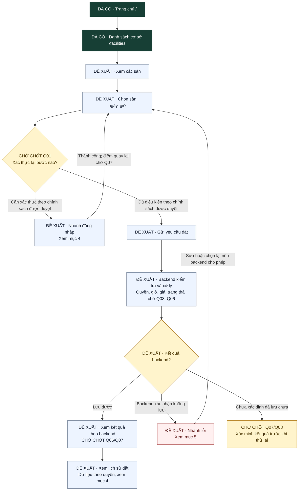
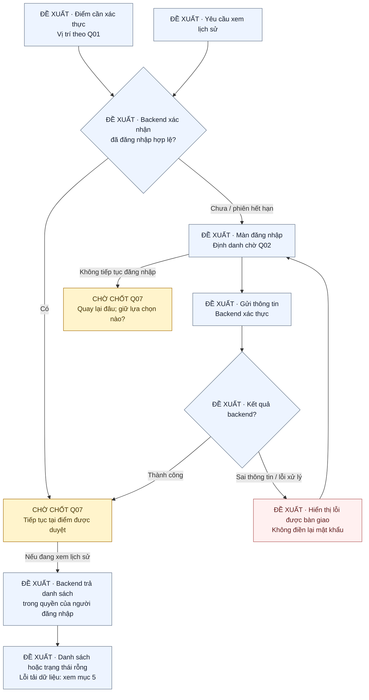
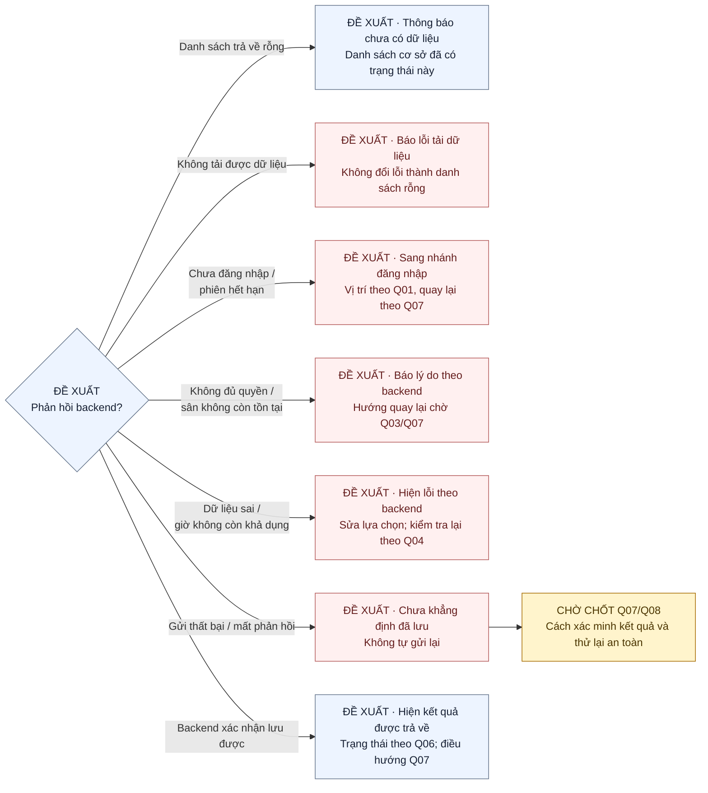

# Bản nháp luồng xem sân, đăng nhập và đặt sân

> **ĐỀ XUẤT — CHỜ NHÓM TRƯỞNG DUYỆT.** Tài liệu tổng hợp cho [issue #15](https://github.com/indominusrex932005-arch/dat-san-tu-dau/issues/15), không phải đặc tả nghiệp vụ đã chốt. Không dùng bản nháp để tự triển khai UI/backend.

Đối chiếu ngày **23/10/2026**, với `main` tại commit [`432e755`](https://github.com/indominusrex932005-arch/dat-san-tu-dau/tree/432e755b7fe6b56f42248261d8506a1f5ed00c29). Luồng dự kiến: **xem cơ sở → xem sân → chọn sân/ngày/giờ → gửi yêu cầu đặt → xem kết quả → xem lịch sử đặt**. Nhánh đăng nhập và lỗi dưới đây cũng là đề xuất để nhóm trưởng xác nhận.

## 1. Phần đã có và phần đang chờ

| Màn/chức năng | Trạng thái tại commit đối chiếu | Bằng chứng hoặc phần cần bàn giao |
| --- | --- | --- |
| Trang chủ | **ĐÃ CÓ** — `GET /` | `routes/home.routes.js`, `controllers/home.controller.js`, `views/home.ejs`; có nút đến `/facilities`. |
| Danh sách cơ sở | **ĐÃ CÓ** — `GET /facilities` | `routes/facility.routes.js`, `controllers/facility.controller.js`, `views/facilities.ejs`; controller đọc `Facility.find()`, có trạng thái rỗng. |
| Danh sách từng sân | **ĐỀ XUẤT, CHƯA CÓ** | [#19](https://github.com/indominusrex932005-arch/dat-san-tu-dau/issues/19) chờ model/quan hệ, route, dữ liệu và mẫu UI từ nhóm trưởng. Cơ sở không đồng nghĩa với từng sân. |
| Chọn sân/ngày/giờ và gửi yêu cầu | **ĐỀ XUẤT, CHƯA CÓ** | [#21](https://github.com/indominusrex932005-arch/dat-san-tu-dau/issues/21) chờ backend đặt sân, giờ khả dụng, quyền, dữ liệu giá và phản hồi. |
| Đăng nhập | **ĐỀ XUẤT, CHƯA CÓ** | [#18](https://github.com/indominusrex932005-arch/dat-san-tu-dau/issues/18) chờ backend, định danh và điều hướng sau đăng nhập. |
| Kết quả gửi yêu cầu đặt | **ĐỀ XUẤT, CHƯA CÓ** | Chờ Q06/Q07: trạng thái và cách trả kết quả, ở cùng màn hay chuyển màn. Chưa khẳng định cần một trang kết quả riêng. |
| Lịch sử đặt | **ĐỀ XUẤT, CHƯA CÓ** | [#22](https://github.com/indominusrex932005-arch/dat-san-tu-dau/issues/22) yêu cầu danh sách backend cho phép người đang đăng nhập được xem; chưa có route/controller/view. |

Chỉ `/` và `/facilities` là đường dẫn trang đã xác minh. Tên các màn đề xuất bên dưới là nhãn để thảo luận, **không phải route hoặc schema được bàn giao**. PR chưa merge không được tính là chức năng đã có trên `main`.

## 2. Cách đọc sơ đồ

- **ĐÃ CÓ**: màn tồn tại trên commit đối chiếu, màu xanh.
- **ĐỀ XUẤT**: bước/màn chưa được viết, màu xanh nhạt. Nhánh lỗi vẫn là đề xuất, dùng màu hồng để dễ thấy.
- **CHỜ CHỐT Qxx**: quyết định thuộc nhóm trưởng, màu vàng; mã Qxx dẫn tới bảng ở mục 6.
- Mũi tên thể hiện hướng đi đang đề xuất, không khẳng định đây là điều hướng đã hoạt động. Trường hợp chưa được chốt phải dừng để thống nhất trước khi code.

Sơ đồ dùng Mermaid, xem trực tiếp trên GitHub. Nguồn độc lập, chỉnh sửa được nằm trong [`luong-su-dung/`](luong-su-dung/). Khi sửa, cập nhật đồng thời khối Mermaid trong tài liệu và tệp `.mmd` tương ứng.

## 3. Luồng chính dự kiến

Nguồn: [`luong-chinh.mmd`](luong-su-dung/luong-chinh.mmd).

**Q01 chưa xác định thời điểm bắt buộc đăng nhập.** Cổng sau bước chọn trong sơ đồ chỉ minh họa chỗ nối sang nhánh đăng nhập; nhóm trưởng có thể đặt cổng ở bước khác sau khi chốt. Không suy ra rằng người xem cơ sở/xem sân bắt buộc đăng nhập, hoặc khách chắc chắn được đặt sân mà không đăng nhập. Điều kiện “đủ” phải do backend đã được duyệt xác định.

“Lưu được” chỉ là kết quả kỹ thuật backend xác nhận; không tự gán cho đơn tên trạng thái như “đã xác nhận”. Bước kết quả và lịch sử có thể cùng màn hoặc khác màn theo Q07, không tự mở thêm trang.

## 4. Nhánh đăng nhập dự kiến

Nguồn: [`dang-nhap.mmd`](luong-su-dung/dang-nhap.mmd).

Đối với lịch sử, điều kiện người đang đăng nhập và dữ liệu đúng quyền lấy từ yêu cầu [#22](https://github.com/indominusrex932005-arch/dat-san-tu-dau/issues/22). Điều đó không quyết định chính sách xem sân hoặc gửi yêu cầu đặt. Nếu quay lại form đặt sau đăng nhập, đề xuất kiểm tra lại lựa chọn với backend; việc giữ sân/ngày/giờ và điểm quay lại vẫn chờ Q07. Không tự động gửi lại yêu cầu đặt sau đăng nhập.

## 5. Nhánh lỗi và trạng thái rỗng dự kiến

Nguồn: [`ket-qua-va-loi.mmd`](luong-su-dung/ket-qua-va-loi.mmd).

| Tình huống | Hướng xử lý để nhóm trưởng duyệt | Điều chưa được suy diễn |
| --- | --- | --- |
| Chưa có cơ sở/sân/lượt đặt | Hiện thông báo rỗng; lối quay lại theo route được bàn giao. | Chỉ trạng thái rỗng của cơ sở đã có trên `main`; hai màn còn lại chưa có. |
| Lỗi tải cơ sở/sân/lịch sử | Báo lỗi rõ, cho thử lại khi backend hỗ trợ. | Chưa có UI lỗi tải dữ liệu được xác minh; không coi lỗi truy vấn là danh sách rỗng. |
| Sai thông tin đăng nhập hoặc phiên hết hạn | Dùng phản hồi backend; không điền lại mật khẩu theo #18. | Không tự chọn email/tên đăng nhập, thời hạn phiên hoặc đích chuyển trang. |
| Thiếu dữ liệu, ngày/giờ không hợp lệ hoặc giờ vừa bị đặt | Giải thích theo lỗi backend; cho sửa/chọn lại dữ liệu phù hợp theo hợp đồng bàn giao. | Không tự đặt độ dài khung giờ, luật trùng lịch hoặc đánh dấu lịch trống. |
| Không đủ quyền hoặc sân không còn tồn tại | Hiện phản hồi theo backend, hướng quay lại theo Q03/Q07. | Không tự định nghĩa vai trò, mã lỗi, quyền quản lý hoặc quyền xem đơn của người khác. |
| Lỗi khi gửi, mất kết nối hoặc chưa biết đã lưu chưa | Nêu kết quả chưa xác định; nhóm trưởng bàn giao cách kiểm tra trước khi thử lại. | Không báo thành công giả, không tự gửi lại hoặc tự đặt cơ chế chống gửi trùng. |

## 6. Quyết định còn mở — nhóm trưởng chốt

Tất cả mục dưới đây hiện là **CHỜ XÁC NHẬN**. Người viết chỉ tổng hợp câu hỏi; các lựa chọn là nội dung cần bàn giao, không phải luật đã duyệt.

| Mã | Cần nhóm trưởng quyết định/bàn giao | Ảnh hưởng tới bản nháp |
| --- | --- | --- |
| Q01 | Người chưa đăng nhập xem cơ sở, xem sân, chọn lịch và gửi yêu cầu được tới bước nào? Cổng xác thực ở đâu? | Vị trí nối nhánh đăng nhập; không mặc định bắt đăng nhập để xem sân. |
| Q02 | Định danh đăng nhập là email, tên đăng nhập hay thông tin khác? Có form/route, input và thông báo nào được bàn giao? | Nội dung màn đăng nhập #18; không tự chọn schema tài khoản. |
| Q03 | Ai được quản lý cơ sở/sân/đơn? Phạm vi từng người được xem và thao tác là gì? | Backend kiểm tra quyền; lịch sử chỉ dùng dữ liệu đã được backend cho phép. Không suy ra quyền từ tên vai trò trong hình minh họa. |
| Q04 | Dùng khung giờ cố định hay giờ bắt đầu/kết thúc? Giờ hoạt động, múi giờ, giới hạn ngày, cách xác định còn trống và trùng lịch? | Cách chọn sân/ngày/giờ và nhánh chọn lại; không tự đặt thời lượng hay lịch khả dụng. |
| Q05 | Giá lấy từ đâu, được tính/hiển thị thế nào, đơn vị gì và xử lý thay đổi giá khi gửi ra sao? | Chỉ hiển thị dữ liệu backend bàn giao; không tự đưa công thức hoặc mức giá vào luồng. |
| Q06 | Các trạng thái đơn, trạng thái sau lưu và quyền chuyển trạng thái? Cần bước duyệt hay không? | Nhãn ở kết quả/lịch sử; không đồng nhất “lưu được” với “đã xác nhận”. |
| Q07 | Sau đăng nhập/lưu/lỗi/quay lại đi đâu? Giữ lựa chọn nào? Kết quả ở cùng màn, màn riêng hay lịch sử? | Hoàn thiện các mũi tên quay lại, tiếp tục và đích sau lưu; chỉ dùng route thật được bàn giao. |
| Q08 | Phản hồi lỗi, trường cần giữ, cách xác minh khi mất phản hồi và điều kiện cho thử gửi lại? | Không tự gửi lại; không trình bày yêu cầu chưa rõ kết quả như đã thất bại hoặc thành công. |
| Q09 | Cung cấp ERD/đặc tả chính thức, phiên bản được duyệt, quan hệ cơ sở–sân và hợp đồng dữ liệu/route cho từng màn. | Đối chiếu lại toàn bộ luồng trước khi chia UI/backend tiếp theo; chưa suy ra schema từ tên màn. |

## 7. Nguồn đã đối chiếu và tài liệu còn thiếu

| Nguồn thực tế | Dùng để xác nhận | Giới hạn |
| --- | --- | --- |
| [Issue #15 do chủ repo cung cấp](https://github.com/indominusrex932005-arch/dat-san-tu-dau/issues/15) | Phạm vi bản nháp, bước chính, các câu hỏi mở và yêu cầu nhóm trưởng duyệt. | Không phải đặc tả đặt sân đã chốt. |
| [`app.js`](../app.js), [`routes/home.routes.js`](../routes/home.routes.js), [`routes/facility.routes.js`](../routes/facility.routes.js), [`controllers/facility.controller.js`](../controllers/facility.controller.js) trên commit đối chiếu | Hai trang đã có; đường dẫn và luồng đọc danh sách cơ sở. | Không chứng minh có backend đăng nhập/sân/đặt sân/lịch sử. |
| [`models/Facility.js`](../models/Facility.js) | Dữ liệu cơ sở hiện có: `name`, `address`, `phone`. | Model này không phải ERD và không xác định quan hệ cơ sở–sân/tài khoản/đơn. |
| [`README.md`](../README.md), [`HUONG_DAN_LAM_VIEC_NHOM.md`](HUONG_DAN_LAM_VIEC_NHOM.md) | Môi trường, cấu trúc dự án và quy trình nhánh/PR/review. | Không cung cấp luật đặt sân. |
| [#18](https://github.com/indominusrex932005-arch/dat-san-tu-dau/issues/18), [#19](https://github.com/indominusrex932005-arch/dat-san-tu-dau/issues/19), [#21](https://github.com/indominusrex932005-arch/dat-san-tu-dau/issues/21), [#22](https://github.com/indominusrex932005-arch/dat-san-tu-dau/issues/22) do chủ repo cung cấp | Phần việc tương lai đang chờ backend và giới hạn của từng màn. | Tên view trong issue chỉ là dự kiến; chưa phải hợp đồng đã bàn giao. |

**Điểm chờ tài liệu:** chưa tìm thấy ERD hoặc đặc tả đăng nhập/đặt sân được bàn giao trong cây `main` và nội dung/bình luận issue #15 tại thời điểm đối chiếu. Nhờ nhóm trưởng bổ sung đúng tệp/URL, phiên bản và xác nhận nguồn tại Q09; không khẳng định nhóm chưa có tài liệu ở nơi khác. Bản nháp không dẫn một ERD tự dựng hoặc coi thiết kế ngoài các nguồn trên là nghiệp vụ đã duyệt.

Tài liệu này không làm lại thiết kế form cơ sở của #8. Không thiết kế thanh toán, đăng ký tài khoản, sân yêu thích hoặc hủy đơn; không thêm schema, route, backend hay dữ liệu vào ứng dụng.

## 8. Bàn giao để review

- [x] Có luồng chính, nhánh đăng nhập, lỗi và danh sách rỗng dự kiến.
- [x] Phân biệt phần đã có, đề xuất và chờ chốt; có nguồn Mermaid chỉnh sửa được.
- [x] Liệt kê Q01–Q09 và ghi rõ tài liệu còn thiếu.
- [ ] Nhóm trưởng xác nhận hướng đi, cung cấp quyết định/tài liệu còn thiếu và yêu cầu sửa nếu có.

PR bản nháp dùng **`Refs #15`** để giữ issue mở. Chỉ dùng luồng này cho công việc UI/backend sau khi nhóm trưởng xác nhận; không tự tích ô duyệt hoặc đóng issue thay người review.
