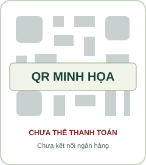
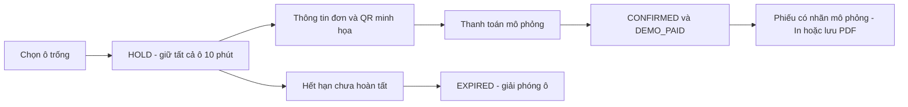

# QR và thanh toán — phần còn dở

## Phần đang chạy để trình bày

Theo lựa chọn của nhóm trưởng, ngân hàng/QR thật sẽ được thầy hướng dẫn sau. Bản này có hình QR minh họa và nút mô phỏng để nhìn thấy luồng từ giữ sân đến phiếu.

Hình này không chứa tài khoản ngân hàng hoặc payload VietQR. `DEMO_MODE=true` chỉ dùng trên máy phát triển. Server từ chối bật demo khi `NODE_ENV=production`.

Nút mô phỏng vẫn kiểm tra CSRF, quyền xem đơn, hạn giữ và đủ ô thuộc đơn. Bấm lại không tạo hai giao dịch ban đầu. Không hồi sinh đơn hết hạn để chiếm ô đã có người khác đặt.

## Công việc cần nối sau

1. Chốt tài khoản nhận tiền và dịch vụ cung cấp thông tin giao dịch. Chưa có tích hợp MB Bank.
2. Tạo QR hợp lệ theo đúng đơn, số tiền và nội dung chuyển khoản.
3. Xác thực callback/webhook/nguồn đối soát theo nhà cung cấp, không tin nút khách bấm hoặc ảnh chuyển khoản.
4. Đối chiếu người nhận, số tiền, mã đơn và hạn giữ. Xử lý tiền thiếu/sai/muộn; không chiếm lại ô đã được người khác đặt.
5. Lưu mã giao dịch ngoài và chặn ghi nhận lặp; cập nhật tiền/đơn/lock trong transaction.
6. Chỉ phát phiếu thật sau khi xác minh trạng thái hợp lệ; giữ tách `DEMO_PAID` với `PAID`.
7. Kiểm thử webhook lặp, sai chữ ký/tiền, xác nhận đồng thời với hết hạn và khởi động lại server.

## Hủy/đổi/hoàn

Khách có tài khoản gửi yêu cầu, chủ sân xét duyệt. Khách vãng lai gọi điện cơ sở. Bản này không tự áp phí đổi 30.000đ hay mức hoàn 100%/50% từ tài liệu gốc.

Chủ sân tự xử lý khoản chênh lệch/hoàn bên ngoài rồi ghi nhận; nút ghi nhận hoàn không chuyển tiền tự động. Đổi toàn đơn trong cùng cơ sở; chưa đổi từng ô hoặc chuyển sang chủ sân khác.

## Cách trình bày với thầy

“Em đã có khách/chủ sân, duyệt quyền theo cơ sở, đặt nhiều ô 30 phút, giữ sân 10 phút và lưu phiếu PDF. Thanh toán đang mô phỏng có nhãn riêng; QR/ngân hàng thật chờ hướng dẫn. Hủy/đổi và ghi nhận hoàn do chủ sân xử lý thủ công.”
