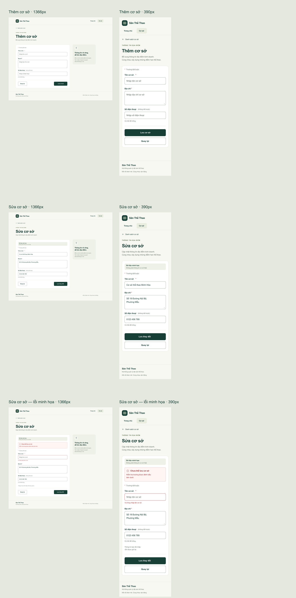

# Thiết kế form thêm và sửa cơ sở

Ngày cập nhật: **23/10/2026**. Thương hiệu: **Sân Thể Thao**.

Tài liệu phục vụ [issue #8](https://github.com/indominusrex932005-arch/dat-san-tu-dau/issues/8): thiết kế giao diện để thống nhất trước khi triển khai. Phạm vi bàn giao là tài liệu và bản thiết kế/xuất hình trong `docs/thiet-ke-co-so/`; không thay đổi EJS, CSS của ứng dụng, model, controller, route hoặc chức năng lưu dữ liệu.

## Trạng thái bàn giao và nguồn tham chiếu

| Hạng mục | Trạng thái |
| --- | --- |
| Tài liệu và quy cách thiết kế | Bản đề xuất để góp ý |
| Bản xem trước và bản xuất | Đã có sáu màn hình dưới dạng SVG/PNG, trang xem trước và ảnh tổng quan |
| Tệp Figma tham chiếu | Đã nhận [tệp do người dùng cung cấp](https://www.figma.com/design/SkrrpLOFhWlQW8rNLHdjnf/Untitled?node-id=4-84); hiện dùng để xem và đối chiếu |
| Các form issue #8 trong Figma | **Chưa xác minh và chưa tích hợp** bốn frame thêm/sửa desktop/mobile cùng các biến thể lỗi; đang chờ kết nối/quyền chỉnh sửa để tiếp tục |
| Phê duyệt của backend lead | **Chưa được phê duyệt** |
| Chức năng thêm/sửa/lưu dữ liệu | Chưa triển khai trong phạm vi thiết kế này |

Nguồn đối chiếu:

- [Issue #8 — yêu cầu thiết kế form cơ sở](https://github.com/indominusrex932005-arch/dat-san-tu-dau/issues/8).
- [PR #4 — giao diện trang chủ](https://github.com/indominusrex932005-arch/dat-san-tu-dau/pull/4), đối chiếu commit [`826095a`](https://github.com/indominusrex932005-arch/dat-san-tu-dau/commit/826095a).
- [PR #5 — giao diện danh sách cơ sở](https://github.com/indominusrex932005-arch/dat-san-tu-dau/pull/5), đối chiếu commit [`2b297d9`](https://github.com/indominusrex932005-arch/dat-san-tu-dau/commit/2b297d9).
- [Tệp tham chiếu do người dùng cung cấp — Figma “Untitled”, node `4:84`](https://www.figma.com/design/SkrrpLOFhWlQW8rNLHdjnf/Untitled?node-id=4-84). Tệp có UI kit và các luồng chủ sân/khách đặt sân; các màn đã quan sát mang thương hiệu “Minh bell”. Cần đối chiếu thêm các thành phần dùng chung trước khi tích hợp form mới.
- Model hiện tại: [`models/Facility.js`](../models/Facility.js). Đây là nguồn xác định các trường dữ liệu; giao diện không thêm trường nghiệp vụ.

Liên kết người dùng gửi là nguồn tham chiếu, chưa chứng minh đã có đầy đủ form thuộc issue #8. Phạm vi thiết kế này vẫn giữ thương hiệu **Sân Thể Thao** và đúng ba trường `name`, `address`, `phone` theo issue/model, không tự lấy thêm trường hoặc thay thương hiệu từ các luồng đặt sân trong tệp tham chiếu.

Các bản xuất SVG là vector có thể nhập vào Figma để tiếp tục chỉnh sửa. SVG/PNG và trang xem trước cục bộ không thay thế cho liên kết tệp Figma hoặc xác nhận phê duyệt. Checklist bàn giao mới hoàn tất phần tài liệu và bản thiết kế cục bộ; phần Figma và duyệt của lead còn chờ.

## Các màn hình cần đối chiếu

| Màn hình | Desktop | Mobile | Nội dung chính |
| --- | --- | --- | --- |
| Thêm cơ sở | Rộng 1366 px | Rộng 390 px | Form trống, `Lưu cơ sở`, `Quay lại` |
| Sửa cơ sở | Rộng 1366 px | Rộng 390 px | Form có dữ liệu ví dụ, `Lưu thay đổi`, `Quay lại` |
| Lỗi nhập liệu | Rộng 1366 px | Rộng 390 px | Thiếu tên bắt buộc; summary và lỗi tại trường; giữ địa chỉ và điện thoại đã nhập |

Chiều cao frame theo nội dung. Bản mobile cho phép cuộn dọc; không ép tất cả nội dung vào một màn hình ngắn. Thanh điều hướng gồm logo chữ **Sân Thể Thao**, `Trang chủ` và `Cơ sở`, giữ ngôn ngữ hình ảnh của hai PR tham chiếu. Phía trên form có đường dẫn trở về mang nhãn `Danh sách cơ sở`.

Các bản xuất đã có trong `docs/thiet-ke-co-so/`. Kích thước dưới đây là chiều rộng × chiều cao thực tế trong [định nghĩa scene `frames.json`](thiet-ke-co-so/frames.json), đồng nhất với từng tệp SVG và PNG:

| Màn hình | Kích thước (px) | Vector để chỉnh sửa | Ảnh để duyệt |
| --- | --- | --- | --- |
| Thêm cơ sở, desktop | 1366 × 1089 | [them-desktop-1366.svg](thiet-ke-co-so/them-desktop-1366.svg) | [them-desktop-1366.png](thiet-ke-co-so/them-desktop-1366.png) |
| Thêm cơ sở, mobile | 390 × 1188 | [them-mobile-390.svg](thiet-ke-co-so/them-mobile-390.svg) | [them-mobile-390.png](thiet-ke-co-so/them-mobile-390.png) |
| Sửa cơ sở, desktop | 1366 × 1157 | [sua-desktop-1366.svg](thiet-ke-co-so/sua-desktop-1366.svg) | [sua-desktop-1366.png](thiet-ke-co-so/sua-desktop-1366.png) |
| Sửa cơ sở, mobile | 390 × 1252 | [sua-mobile-390.svg](thiet-ke-co-so/sua-mobile-390.svg) | [sua-mobile-390.png](thiet-ke-co-so/sua-mobile-390.png) |
| Lỗi khi sửa, desktop | 1366 × 1331 | [loi-desktop-1366.svg](thiet-ke-co-so/loi-desktop-1366.svg) | [loi-desktop-1366.png](thiet-ke-co-so/loi-desktop-1366.png) |
| Lỗi khi sửa, mobile | 390 × 1421 | [loi-mobile-390.svg](thiet-ke-co-so/loi-mobile-390.svg) | [loi-mobile-390.png](thiet-ke-co-so/loi-mobile-390.png) |

[Mở trang xem trước `preview.html`](thiet-ke-co-so/preview.html) sau khi tải/mở tệp cục bộ. Trang dựng các scene bằng phần tử HTML/SVG trong DOM, có điều hướng đến từng màn; đây là bản thiết kế tĩnh, không phải form chức năng và không gửi hoặc lưu dữ liệu. [`frames.json`](thiet-ke-co-so/frames.json) lưu cấu trúc scene, tọa độ, nội dung và token để đối chiếu hoặc tái dựng bản xuất.

Ảnh tổng quan giúp duyệt nhanh; dùng các liên kết PNG phía trên để xem chữ ở kích thước đầy đủ:

### Nhập SVG vào Figma khi cần

Đây là phương án chuyển bản thiết kế cục bộ vào Figma trong lúc chờ kết nối/quyền chỉnh sửa, chưa phải bằng chứng đã tích hợp form mới vào tệp tham chiếu:

1. Mở tệp tham chiếu trong không gian Figma của nhóm sau khi có quyền chỉnh sửa phù hợp.
2. Kéo sáu tệp SVG ở bảng trên vào canvas. Giữ mỗi màn thành một nhóm/frame riêng và đặt tên theo tên tệp.
3. Đối chiếu kích thước với bảng; kiểm tra phông Arial, dấu tiếng Việt, vị trí các trường và nội dung xuống dòng sau khi nhập. Không dùng PNG làm nguồn chỉnh sửa vector.
4. Sắp xếp các màn thêm/sửa/lỗi theo hai kích thước, bổ sung chú thích hành vi từ tài liệu này và đặt quyền chia sẻ phù hợp cho người duyệt.
5. Sau khi nhập và kiểm tra thực tế, bổ sung liên kết đến từng frame mục tiêu: thêm desktop 1366, thêm mobile 390, sửa desktop 1366, sửa mobile 390; kèm biến thể lỗi ở hai kích thước. Chỉ cập nhật trạng thái phê duyệt khi lead đã xác nhận.

SVG cho phép chỉnh sửa các phần tử vector; việc chuyển thành component, Auto Layout hoặc prototype Figma cần thực hiện và kiểm tra thêm. Hiện chưa xác nhận các cấu trúc Figma này đã có.

### Checklist hiện tại

- [x] Có sáu bản xuất desktop/mobile cho thêm, sửa và lỗi minh họa; có PNG, SVG và ảnh tổng quan.
- [x] Đối chiếu kích thước của sáu scene trong JSON với SVG và header PNG; các kích thước khớp bảng trên.
- [x] Tài liệu liên kết được đến các tệp bàn giao và model; chỉ dùng ba trường có trong model.
- [ ] Xác minh/tích hợp bốn frame thêm/sửa desktop/mobile và hai biến thể lỗi trong Figma; bổ sung liên kết trực tiếp đến các frame đã kiểm tra.
- [ ] Backend lead xác nhận duyệt thiết kế và các quyết định còn mở.

Checklist chưa hoàn tất; không dùng phần đã xong để đóng thay các yêu cầu Figma hoặc phê duyệt còn chờ.

### Kiểm tra bản đề xuất cục bộ — 23/10/2026

- Đã xem trực quan cả sáu PNG: chữ tiếng Việt, nhãn, nút và thông báo lỗi không bị cắt hoặc chồng lên nhau.
- Đã mở `preview.html` bằng trình duyệt và đo các phần tử chữ trong cả sáu frame: không có phần tử vượt ra khỏi biên frame; đúng ba vùng nhập `name`, `address`, `phone` ở mỗi màn.
- Kích thước của PNG, SVG và JSON khớp nhau ở cả sáu màn; các liên kết tệp trong tài liệu có đích tồn tại.
- Các kiểm tra này chỉ xác nhận bản thiết kế cục bộ. Chưa kiểm thử thao tác nhập/lưu, chưa kiểm tra bản thiết kế được nhập sang Figma và chưa dùng dữ liệu MongoDB.

## Trường dữ liệu và nội dung

| Thuộc tính model | Nhãn hiển thị | Thành phần thiết kế | Bắt buộc | Ràng buộc hiện có |
| --- | --- | --- | --- | --- |
| `name` | Tên cơ sở | Ô nhập một dòng | Có | `String`, `required: true`, `trim: true` |
| `address` | Địa chỉ | Ô nhập nhiều dòng | Có | `String`, `required: true`, `trim: true` |
| `phone` | Số điện thoại | Ô nhập một dòng, ghi rõ `không bắt buộc` | Không | `String`, `trim: true` |

`address` dùng ô nhiều dòng để đọc và nhập địa chỉ thuận tiện; giá trị vẫn là một chuỗi. `phone` giữ nguyên dạng chuỗi, kể cả số 0 ở đầu. Thiết kế không tự thêm kiểm tra độ dài, đầu số, quốc gia, mẫu ký tự hoặc tính duy nhất cho điện thoại. Không có giới hạn ký tự mới cho tên hoặc địa chỉ.

`_id`, `createdAt`, `updatedAt` thuộc định danh/thông tin hệ thống, không phải trường nhập của form này. Không thêm loại sân, giá, hình ảnh, trạng thái, người quản lý hoặc thông tin đặt sân.

Các trường `name` và `address` có dấu `*`; chú thích đầu form là **“* Trường bắt buộc”**. Điện thoại ghi **“(không bắt buộc)”** và trợ giúp **“Có thể để trống.”** Nhãn hiển thị thường trực, không dùng placeholder thay cho nhãn.

### Dữ liệu minh họa

Mọi dữ liệu điền sẵn chỉ là ví dụ, **không phải dữ liệu cơ sở hay thông tin liên hệ thật**. Màn sửa và màn lỗi có dải chú thích ngoài giá trị nhập, gồm hai dòng: **“Dữ liệu minh họa”** và **“Không phải thông tin cơ sở thật.”**

| Trường | Giá trị điền sẵn trên bản sửa |
| --- | --- |
| Tên cơ sở | `Cơ sở thể thao Minh Hòa` |
| Địa chỉ | `Số 18 Đường Nội Bộ, Phường Mẫu` |
| Số điện thoại | `0123 456 789` — số minh họa |

Màn lỗi để trống tên cơ sở, giữ nguyên địa chỉ và số điện thoại ví dụ ở trên. Số điện thoại minh họa không xác lập quy tắc định dạng, tính hợp lệ hay khả năng liên lạc.

## Bố cục và quy cách hình ảnh

### Màu và kiểu chữ

| Token | Giá trị | Cách dùng |
| --- | --- | --- |
| Xanh thương hiệu | `#173f35` | Logo, tiêu đề, nút chính |
| Nền kem | `#f7f8f2` | Nền trang |
| Nền thẻ | `#ffffff` | Form và ô nhập |
| Chữ phụ | `#5c6c61` | Mô tả, chú thích |
| Viền thẻ/đường chia | `#dce2d5` | Thẻ và đường phân cách |
| Viền ô nhập | `#7b887b` | Viền trường và nút phụ |
| Lỗi | `#a52f2f` | Viền trường lỗi, thông báo lỗi và dấu bắt buộc; luôn có chữ mô tả đi kèm |
| Nền summary lỗi | `#fff5f3` | Nền vùng thông báo lỗi |
| Viền summary lỗi | `#dcaca5` | Viền vùng thông báo lỗi |
| Nền ghi chú | `#eef1e7` | Dải dữ liệu minh họa và thẻ ghi chú desktop |
| Phông chữ | Arial, sans-serif | Toàn bộ màn hình |

Tiêu đề trang desktop **50 px**, mobile **34 px**, đậm 700. Nhãn trường **14 px**, đậm 700; nội dung ô nhập **16 px**. Chữ trợ giúp và lỗi tại trường 12 px; dòng bắt buộc, mô tả summary và ghi chú desktop 13 px; dòng giải thích dữ liệu minh họa 11 px. Nhãn nút 15 px đậm 700. Scene tĩnh đặt vị trí từng dòng để kiểm soát xuống dòng; khi triển khai cần kiểm tra lại line-height với nội dung động. Không dùng màu làm dấu hiệu duy nhất của trạng thái lỗi hoặc bắt buộc.

### Desktop 1366 px

- Khung nội dung tối đa 1180 px, căn giữa; tại 1366 px hai lề là 93 px.
- Form chính rộng 712 px, padding trong thẻ 32 px; trường nhập rộng 648 px. Ghi chú bên cạnh rộng 300 px, cách form 40 px.
- Nhóm nhãn, ô nhập và trợ giúp đi theo một cột. Tọa độ đầu nhãn đến đầu ô cách 27 px; khoảng cách từ đáy ô đến nhãn nhóm tiếp theo là 24 px khi không có lỗi. Bản lỗi thêm khoảng cho thông báo tại trường.
- Ô nhập một dòng cao 52 px, textarea cao 104 px; padding ngang nội dung 14 px; bo góc ô 8 px, thẻ 14 px.
- Nút cao 52 px. `Quay lại` ở đầu trái, nút chính ở đầu phải của hàng hành động. Nút chính được nhận diện bằng nền xanh và chữ trắng.

### Mobile 390 px

- Lề trang 20 px mỗi bên, nội dung rộng 350 px. Form một cột; padding trong thẻ 20 px, chiều rộng trường theo phần còn lại của thẻ.
- Không hiển thị thẻ ghi chú bên cạnh trên 390 px; giữ một cột. Dải dữ liệu minh họa của màn sửa/lỗi vẫn nằm trong thẻ form.
- Ô một dòng cao 52 px, textarea cao 104 px; giữ bo góc 8/14 px như desktop.
- Nút hành động xếp dọc: nút chính trước, `Quay lại` sau; rộng 310 px, cao 52 px; khoảng cách 12 px. Cho phép tiêu đề, địa chỉ và thông báo lỗi xuống dòng, không cắt chữ hay gây cuộn ngang.
- Trường nhập rộng 310 px, padding ngang nội dung 14 px. Khoảng cách từ đáy ô đến nhãn nhóm tiếp theo là 24 px khi không lỗi; đầu nhãn đến đầu ô cách 27 px, như desktop.

## Trạng thái và hành vi dự kiến

Các hành vi dưới đây là đặc tả thiết kế để bàn giao. Bản thiết kế không thực thi kiểm tra dữ liệu, gọi mạng hoặc cập nhật cơ sở dữ liệu.

| Trạng thái | Cách thể hiện |
| --- | --- |
| Mặc định | Viền trung tính, nhãn rõ; trường điện thoại ghi không bắt buộc |
| Focus | Viền/vòng focus nhìn thấy rõ, không chỉ đổi màu chữ |
| Đã nhập | Nội dung vẫn đọc được, nhãn không biến mất |
| Lỗi trường | Viền lỗi và thông báo bằng chữ ngay dưới trường; liên hệ với trường tương ứng |
| Lỗi toàn form | Summary nằm trước các trường; nội dung dẫn người dùng đến trường cần sửa |

Ví dụ lỗi dùng đúng yêu cầu `name` bắt buộc đã có trong model:

- Summary: **“Chưa thể lưu cơ sở”**, kèm **“Kiểm tra trường được đánh dấu bên dưới.”**
- Trường tên: **“Vui lòng nhập tên cơ sở.”**
- Địa chỉ và điện thoại đã nhập vẫn giữ nguyên để người dùng sửa thiếu sót mà không nhập lại. Ghi chú cuối form: **“Thông tin bạn đã nhập vẫn được giữ lại.”**

Chỉ ô `name` có viền lỗi và thông báo inline trong biến thể này. Dấu bắt buộc của cả `name` và `address` vẫn có ở mọi màn; dấu `*` không đồng nghĩa với trường đang lỗi. Biến thể lỗi dùng màn sửa với nút `Lưu thay đổi`.

Đây là nội dung lỗi minh họa, không phải bản sao thông báo lỗi thật của backend. Câu chữ và hình thức phản hồi cuối cùng cần thống nhất với backend lead. Không suy diễn thêm quy tắc kiểm tra cho điện thoại hoặc ràng buộc chưa có trong model.

`Lưu cơ sở` và `Lưu thay đổi` diễn đạt hành động theo chế độ form. `Quay lại` thể hiện ý định trở về màn trước; đích điều hướng, cảnh báo khi có thay đổi chưa lưu và kết quả sau khi lưu chưa được chốt. Tài liệu không quy định URL submit, HTTP method hoặc tự tạo endpoint thêm/sửa. Các liên kết điều hướng trong bản vẽ chỉ giúp nhận diện luồng, không xác nhận có sẵn route tương ứng.

## Khả năng tiếp cận khi triển khai

- Dùng một tiêu đề chính và nhãn gắn với từng ô nhập. Thông tin bắt buộc phải có ý nghĩa ngữ nghĩa và mô tả bằng chữ ngoài dấu `*`.
- Thứ tự bàn phím theo thứ tự nhìn: điều hướng, tên, địa chỉ, điện thoại, các hành động. Các hành động desktop đọc từ trái sang phải, mobile từ trên xuống dưới; DOM khi triển khai cần tương ứng cách hiển thị. Tất cả nút và liên kết có focus nhìn thấy được.
- Khi có lỗi, hỗ trợ thông báo summary cho công nghệ đọc màn hình; liên kết thông báo tại trường bằng `aria-describedby` và đánh dấu trường lỗi bằng `aria-invalid` khi triển khai.
- Summary nên hỗ trợ đưa người dùng đến trường lỗi. Chọn cách chuyển focus sau khi submit cùng người triển khai; không tự động chuyển focus chỉ vì mở trang.
- Mục tiêu tương tác cao tối thiểu 48 px. Chữ có độ tương phản đủ đọc; lỗi không chỉ được phân biệt bằng màu.
- Kiểm tra xuống dòng với tên/địa chỉ dài, phóng to chữ và thu hẹp viewport. Bản mobile 390 px không được xuất hiện cuộn ngang.
- Có thể dùng bàn phím điện thoại phù hợp cho `phone`, nhưng không biến thao tác gợi ý bàn phím thành quy tắc kiểm tra mới.

## Các điểm cần backend lead chốt

1. Chấp thuận ba trường và cách đánh dấu bắt buộc theo model hiện tại; xác nhận có cần thay đổi nghiệp vụ trong một issue triển khai riêng hay không.
2. Quy tắc kiểm tra ngoài `required`/`trim` hiện có, nếu thực sự cần; đặc biệt định dạng điện thoại, giới hạn ký tự và kiểm tra trùng. Bản thiết kế chưa áp dụng các quy tắc này.
3. Quyền truy cập form, nguồn dữ liệu khi sửa và xử lý trường hợp cơ sở không còn tồn tại.
4. Route, HTTP method, bảo vệ request, payload và cơ chế lưu; chưa được quyết định bởi bản thiết kế.
5. Câu chữ lỗi, cách hiển thị lỗi từ server và cách giữ lại dữ liệu người dùng đã nhập khi lỗi.
6. Phản hồi sau khi lưu, trạng thái đang lưu/chống gửi trùng, điều hướng sau thành công, hành vi `Quay lại` và thay đổi chưa lưu.
7. Đối chiếu UI kit trong tệp Figma tham chiếu, duyệt bốn frame thêm/sửa tại 1366 px và 390 px cùng hai biến thể lỗi, nội dung mẫu và bản Figma sau khi có kết nối/quyền chỉnh sửa.

Chỉ đánh dấu hoàn tất bước duyệt khi các frame Figma mục tiêu đã được xác minh, có liên kết trực tiếp sử dụng được và có xác nhận rõ ràng từ người có trách nhiệm. Liên kết tệp tham chiếu do người dùng cung cấp chưa thay thế các điều kiện này. Hiện tại tài liệu ghi nhận bản đề xuất và các điểm còn chờ; không xem các mục trên là đã được phê duyệt.
