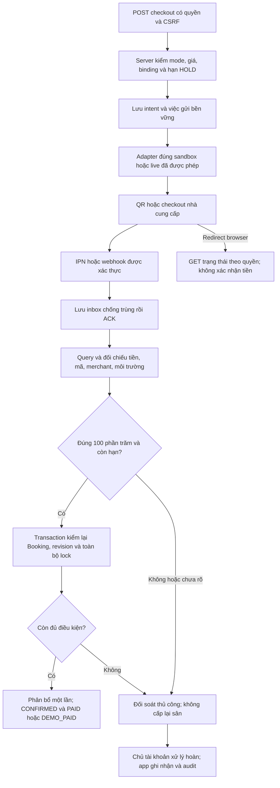

# Thiết kế thanh toán QR — #84

Ngày đối chiếu nguồn: **05/11/2026**. Trạng thái: **ĐỀ XUẤT, CHỜ NHÓM TRƯỞNG/THẦY CHỐT**. Chưa chọn nhà cung cấp hoặc tài khoản nhận tiền; chưa mở merchant, nhận secret, gọi API tạo giao dịch hay chuyển tiền thật. Tài liệu này chưa đủ để đóng [#84](https://github.com/indominusrex932005-arch/dat-san-tu-dau/issues/84).

Nguồn code đã đọc: main `5c3e72d50a9802a1533a9ca7b17db0fb8fc3aa47`. Hợp đồng mode tham chiếu [PR #95 / #81](https://github.com/indominusrex932005-arch/dat-san-tu-dau/pull/95), SHA `2aa7942cb0132230336d7b57a1eea22cff1ef6ef`, đang chờ tích hợp tại lúc soạn. Nhánh thiết kế chỉ thêm tài liệu, không đưa code live vào ứng dụng.

## 1. Phần đã có và phần chưa có

| Đã có trong code main | Chưa có; mọi thiết kế bên dưới là đề xuất |
| --- | --- |
| Booking lưu giá từng ô 30 phút và tổng nguyên đồng; giữ tất cả ô bằng transaction | PaymentIntent, webhook/IPN, truy vấn nhà cung cấp và đối soát giao dịch thật |
| Hạn HOLD là mốc sớm hơn giữa tạo đơn +10 phút và giờ ô đầu; SlotLock có unique sân/giờ | Merchant/tài khoản ngân hàng đã liên kết, ledger tiền nhận/phân bổ/hoàn, outbox và worker phục hồi |
| Mô phỏng ghi `INITIAL_DEMO`/`EXTRA_DEMO`, phương thức `DEMO`, Booking `DEMO_PAID` | Writer live hợp lệ cho `PAID`; enum `PAID` có sẵn không chứng minh đã nhận tiền |
| Hủy/đổi theo quyền; OWNER ghi nhận hoàn thủ công | Thu thêm live có bằng chứng và chống hoàn vượt số tiền thực nhận |

Checkbox `extraPaymentConfirmed` và trạng thái hoàn `TRANSFERRED` hiện là ghi nhận thủ công, không phải xác nhận ngân hàng. QR minh họa, ảnh chuyển khoản, nút “đã trả” và redirect thành công đều không chứng minh tiền về. Xem [phần thanh toán đang dở](THANH_TOAN_CON_DANG_DO.md).

## 2. So sánh dịch vụ theo nguồn chính thức

Các thông tin dưới đây là tài liệu công khai tại ngày đối chiếu, chưa phải hợp đồng/báo giá cho merchant của nhóm. Tài khoản nhận tiền phải được ngân hàng và dịch vụ chấp nhận đúng chủ thể, loại tài khoản và sản phẩm.

| Phương án | Môi trường thử | Ngân hàng/người nhận | Phí và điều kiện cần xác nhận |
| --- | --- | --- | --- |
| payOS Payment Requests | **Không có sandbox riêng**; hướng dẫn thử sử dụng tài khoản/ngân hàng thật. Không thực hiện luồng đó trong task này. [Môi trường test](https://payos.vn/docs/moi-truong-test/) | Kênh thanh toán của chủ thể đã xác minh, gắn ngân hàng nhận tiền. Nguồn hiện có hướng dẫn MB, BIDV, ACB, OCB, KienlongBank, MSB, Vietcombank; không mặc định mọi tài khoản đều đủ điều kiện. [Hướng dẫn hiện hành](https://payos.vn/tao-ma-qr-ngan-hang-mien-phi-chuan-vietqr/) | Có giới thiệu dịch vụ miễn phí; vẫn cần xác nhận hạn mức tạo link, điều kiện ngân hàng và quyền merchant. Không hứa miễn phí vô hạn. [Thông tin phí công khai](https://payos.vn/tao-ma-qr-ngan-hang-mien-phi-chuan-vietqr/) |
| **SePay Payment Gateway/Checkout** | Có Sandbox cách ly tiền thật, credential riêng, không cần liên kết ngân hàng thật để thử. [Sandbox](https://developer.sepay.vn/vi/cong-thanh-toan/sandbox) | Merchant và phương thức VietQR phải được kích hoạt đúng điều kiện; danh sách ngân hàng/loại tài khoản của merchant cụ thể cần SePay xác nhận, không suy từ sản phẩm Webhook. [Giới thiệu](https://developer.sepay.vn/vi/cong-thanh-toan/gioi-thieu) | Bảng gói ghi FREE 0đ/tháng, 50 giao dịch tiền vào/tháng và tính phí khi vượt; SHOP không có API/cổng thanh toán. Cần báo giá đúng sản phẩm, phương thức, phí vượt/ngân hàng/VAT trước chọn. [Bảng giá](https://sepay.vn/bang-gia.html) |
| SePay Bank Webhook + API | Có Test mode mô phỏng độc lập; tự xây dựng QR/đối soát nhiều hơn Gateway. [Test mode](https://developer.sepay.vn/vi/sepay-webhooks/test-mode/bat-dau-nhanh) | Chỉ tài khoản đã liên kết và ngân hàng hỗ trợ. MB/ACB/TPBank có hỗ trợ cá nhân/doanh nghiệp; Vietcombank, BIDV có ràng buộc loại tài khoản/VA cụ thể. [Bảng khả năng ngân hàng](https://developer.sepay.vn/vi/sepay-webhooks/tai-khoan-ngan-hang) | Kiểm tra gói API/Webhook và báo giá merchant; không lấy phí/thẩm quyền của Gateway áp mặc nhiên cho Bank Hub hay API ngân hàng. [Phạm vi API v2](https://developer.sepay.vn/vi/sepay-api/v2/gioi-thieu) |

**Đề xuất để nhóm trưởng review:** thử tích hợp **SePay Payment Gateway Sandbox**, chỉ phương thức chuyển khoản QR, với một merchant giả lập của nhóm. Lý do là có luồng checkout/IPN/query cách ly tiền thật. Đây là lựa chọn POC được đề xuất, **chưa phải dịch vụ live đã chốt**, không phải quyết định gom tiền thật của các OWNER vào tài khoản chung. payOS vẫn là phương án thay thế nếu điều kiện thử/merchant được nhóm trưởng và chủ tài khoản thống nhất.

Điều kiện mở merchant live không được bỏ qua: payOS yêu cầu xác minh chủ thể và tên tài khoản ngân hàng phù hợp [hướng dẫn xác thực](https://payos.vn/docs/huong-dan-su-dung/xac-thuc-to-chuc/). SePay ghi nhận bước xác thực SĐT và ký hợp đồng, khác nhau giữa cá nhân/doanh nghiệp; hồ sơ KYC/ngân hàng cụ thể vẫn phải xác nhận cho merchant dự kiến tại D03/D04. [Changelog SePay](https://developer.sepay.vn/vi/changelog).

Giới hạn cần chấp nhận trước chọn Gateway: đặc tả form chưa ghi tham số expiry tương ứng hạn HOLD. App phải tự chặn xác nhận quá hạn; không hứa mã QR ngừng nhận chuyển khoản đúng lúc sân hết giữ. [Form checkout](https://developer.sepay.vn/vi/cong-thanh-toan/API/don-hang/form-thanh-toan). QR của dịch vụ khác có expiry cũng không thay quy tắc chống tiền đến muộn của app.

## 3. Quyết định còn chờ và mô hình nhiều OWNER

| Mã | Cần chốt | Đề xuất/phần cần bàn giao | Người xác nhận / ngày / bằng chứng |
| --- | --- | --- | --- |
| D01 | Nhà cung cấp + sản phẩm | POC SePay Gateway Sandbox; nhà cung cấp live chưa chọn | **CHƯA CÓ** |
| D02 | Tiền thật về đâu | Chọn một trong hai mô hình bên dưới; chưa mặc định tài khoản chung | **CHƯA CÓ** |
| D03 | Chủ thể sở hữu, ngân hàng và quyền sử dụng | Chủ tài khoản tự kết nối/xác minh; báo cáo chỉ ghi alias binding đã xác minh, không STK/giấy tờ/secret | **CHƯA CÓ** |
| D04 | Gói/phí/hạn mức/điều kiện nhận tiền cho nhiều OWNER | Báo giá và điều kiện đúng sản phẩm; ngân hàng/loại tài khoản, merchant, hoàn và quyền nhận hộ nếu có | **CHƯA CÓ** |
| D05 | Người sửa cấu hình, người xử lý hoàn | OWNER chỉ đề nghị liên kết cơ sở mình; ADMIN/operator duyệt binding; chủ tài khoản thực hiện chuyển hoàn | **CHƯA CÓ** |
| D06 | Tiền thiếu/thừa/muộn và webhook đến trễ | Đề xuất đưa đối soát thủ công, không tự xác nhận sau hạn; chốt thời gian xử lý và trách nhiệm thông báo | **CHƯA CÓ** |
| D07 | Thu thêm khi đổi sân | Deadline riêng cho yêu cầu đổi và cơ chế giữ ô đích; chưa dùng hạn HOLD của đơn ban đầu | **CHƯA CÓ** |
| D08 | Cho phép triển khai live | Chỉ sau thiết kế được duyệt, merchant/binding hợp lệ, sandbox/test đạt và PR triển khai được review | **CHƯA CÓ** |

Khi có quyết định, cập nhật từng dòng bằng tên/vai trò người chốt, ngày và tham chiếu xác nhận được phép công khai. Ý kiến người viết hoặc đề xuất trong PR không được ghi thành quyết định của nhóm trưởng/thầy. Không gửi mật khẩu, OTP, CCCD, API key hay số tài khoản vào issue.

| Mô hình nhận tiền | Cơ chế cần có trước live | Hoàn tiền/quyền vận hành |
| --- | --- | --- |
| Một tài khoản chung | Một merchant/chủ tài khoản có quyền nhận tiền cho mô hình đã thống nhất; từng giao dịch vẫn gắn facility/OWNER và có sổ đối soát riêng. Cần dịch vụ xác nhận quyền nhận hộ/phân bổ; không tự xây cơ chế chia tiền khi chưa có thỏa thuận | OWNER đề nghị; chủ tài khoản hoặc người được ủy quyền thực hiện và đối soát. Cần chốt trách nhiệm phân chia/quyết toán, không mặc định app đã hỗ trợ |
| Tài khoản riêng từng OWNER | Mỗi OWNER/merchant tự kết nối hợp lệ; server lưu binding đã xác minh theo cơ sở, credential tách tenant hoặc quy trình ủy quyền mà sản phẩm hỗ trợ | OWNER đúng cơ sở và đúng thẩm quyền xử lý; ADMIN không dùng một secret chung để đọc mọi tài khoản |

Chỉ nhập STK của OWNER không cấp quyền đọc giao dịch. SePay có luồng [OAuth có consent](https://developer.sepay.vn/vi/sepay-oauth2/luong-xac-thuc) và [Bank Hub](https://developer.sepay.vn/vi/bankhub/tong-quan), nhưng đó không phải bằng chứng merchant Gateway thông thường hỗ trợ marketplace/chia tiền. Nếu chọn nhận riêng, phải xác nhận đúng sản phẩm, ngân hàng, scope và quy trình thu hồi quyền trước khi thiết kế adapter cuối cùng. Với payOS cũng phải tuân thủ chủ thể/kênh đã được dịch vụ cho phép, không đổi tài khoản đích tùy ý từ body tạo đơn. [Điều khoản payOS](https://payos.vn/thoa-thuan-su-dung/).

## 4. Một hợp đồng mode với #81

Giữ **duy nhất `PAYMENT_MODE`** làm quyền bật thanh toán trên server theo PR #95. Cấu hình chọn nhà cung cấp không được tự bật live hoặc ghi đè mode. Main tại SHA trên còn dùng `DEMO_MODE`; hợp nhất #95 trước khi triển khai adapter, không thêm một bộ cờ legacy song song.

| Mode / adapter đề xuất | Kết quả được phép |
| --- | --- |
| `off` | Không tạo yêu cầu thu tiền hoặc mô phỏng mới, không cho client bật lại. Phiếu lịch sử vẫn giữ nhãn thật/mô phỏng đã lưu |
| `demo`, không có adapter ngoài | Giữ luồng mô phỏng nội bộ hiện có |
| `demo`, adapter SePay Gateway đã được cấu hình | **Chỉ Sandbox**, credential/binding/DB thử riêng; dù nhà cung cấp trả thành công vẫn ghi `DEMO_PAID`, phiếu ghi mô phỏng |
| `demo`, adapter payOS | Từ chối thử thanh toán thật: tài liệu hiện không có sandbox riêng để ánh xạ mode này |
| `live` | **Hiện startup bị PR #95 chặn**; chỉ mở trong PR triển khai sau các điều kiện D01–D08, không tự fallback demo |

Môi trường/host API được suy từ mode và adapter đã cho phép, không dùng cờ `LIVE_ENABLED` hoặc nhận URL API/mode từ client. Sự kiện demo không được trả cho intent live và ngược lại. Khi tắt sau một giai đoạn live, sự kiện của intent live cũ phải còn được ghi vào inbox đối soát an toàn; đề xuất không tự cấp sân trong mode off. Không vứt thông báo tiền đã tới hoặc coi off là ngân hàng đã dừng nhận tiền.

DB/tài khoản mẫu không dùng chung live. `DEMO_PAID`, đơn `legacy`, hoặc việc đổi mode không được tự chuyển đơn cũ thành `PAID`. Mọi migration/unique index mới phải có dry-run và kiểm thử DB cục bộ riêng; task này không migrate/seed/sửa Atlas.

## 5. Hợp đồng yêu cầu thanh toán phía server — đề xuất

### Tạo intent và mã đối soát

1. Xác thực session hoặc capability guest hiện có; kiểm tra CSRF cho POST trình duyệt, quyền cơ sở/đơn và mode. Không nhận owner/merchant/giá/trạng thái từ body làm nguồn quyết định.
2. INITIAL lấy **100% `Booking.totalPrice`**, đối chiếu tổng `slots[].priceVND` đã lưu. EXTRA chỉ lấy **100% khoản chênh lệch dương** do server snapshot cho đúng yêu cầu CHANGE/revision, không thu lại tổng Booking. Dùng VND nguyên an toàn, không chia cọc hoặc tự áp phí. Nếu khoản phải thu bằng 0, dừng luồng thu tiền và chuyển xử lý riêng cần chốt, không tự giả tạo giao dịch thành công.
3. Tạo mã đối soát duy nhất bằng server và unique index. Lưu cùng booking, revision/purpose, mode, merchant/binding version, số tiền và deadline; không dùng số điện thoại hay guest token làm mã. Mã này không cấp quyền xem phiếu.
4. Với INITIAL, deadline không muộn hơn `effectiveHoldExpiresAt(booking)`; provider cần UNIX seconds thì làm tròn xuống, không kéo dài hạn. Không tạo link nếu deadline đã tới. Nếu API không có expiry, vẫn áp deadline server và chuẩn bị đối soát khoản đến muộn.
5. Lưu intent và thao tác cần gửi bền vững trước gọi dịch vụ. Gọi mạng **ngoài** transaction MongoDB có thể retry. Timeout sau create là kết quả chưa rõ: query bằng mã đã lưu trước, không tạo mã/đơn thu mới ngay. Chỉ dùng idempotency key của provider nếu hợp đồng chính thức hỗ trợ.
6. Amount trên form/link được server ký theo đặc tả adapter; URL return/cancel/IPN do server cấu hình trên origin HTTPS cho phép. Client không chọn người nhận hoặc sửa đường dẫn redirect tùy ý. Hạn mức độ dài/kiểu mã phải kiểm thử với đúng provider.

### Dữ liệu tối thiểu cần bổ sung trong PR triển khai

Tên dưới đây là thiết kế nội bộ, **chưa phải model/field đang chạy** và không khẳng định là tên trường của provider.

| Thành phần đề xuất | Dữ liệu/ràng buộc cần có |
| --- | --- |
| PaymentIntent | booking, revision, INITIAL/EXTRA, expectedAmountVND, currency, expiresAt, reconciliationCode, provider, environment, merchant/binding version, providerOrderId, trạng thái tạo/chờ/kết quả chưa rõ/cần đối soát; unique mã + không có hai intent thu trùng cùng purpose/revision đang hiệu lực |
| PaymentInbox / BankMovement | Dấu vết xác thực, ID sự kiện nếu có, ID giao dịch tiền ổn định, provider/merchant/environment, mã tương quan, amount/currency, thời gian nhận; unique theo scope đúng. Delivery ID và bank transaction ID không mặc định giống nhau |
| PaymentAllocation | Giao dịch đã xác minh được phân bổ cho đúng intent/booking/revision; unique chống một lần tiền cấp hai đơn hoặc xác nhận hai lần |
| Outbox / recovery | Thao tác tạo/query/cancel cần phục hồi, số lần thử/backoff, kết quả chưa rõ; không lưu secret vào payload/log |
| RecipientBinding / RefundLedger | Binding đã xác minh có phiên bản và thẩm quyền; tiền nhận, đã phân bổ, cần hoàn, hoàn đang xử lý/đã ghi nhận và business key chống trùng |

Không tái sử dụng index chỉ bảo vệ `INITIAL_DEMO` hiện tại để khẳng định live idempotent. Khóa chống trùng dùng ID giao dịch trong namespace ổn định của provider/môi trường/merchant hoặc tài khoản nhận đã xác minh. **Binding version chỉ là snapshot audit, không tạo namespace tiền mới** để replay giao dịch sau rotate/đổi cấu hình. Khóa allocation ràng buộc intent/booking. Mapping ID provider phải được chứng minh bằng fixture sandbox và query, không đoán từ tên trường; một lần tiền thực không được phân bổ lại qua hai adapter khác nhau.

## 6. Xác thực, query trạng thái và webhook

| Adapter | Hợp đồng phải bám đúng khi triển khai |
| --- | --- |
| SePay Gateway, đề xuất POC | Form checkout dùng HMAC-SHA256; REST query dùng Basic Auth của merchant. IPN chọn `SECRET_KEY`, xác thực `X-Secret-Key` bằng **khóa IPN riêng**, không đồng nhất khóa ký form. Đây không phải HMAC raw-body của sản phẩm Bank Webhook. [Form](https://developer.sepay.vn/vi/cong-thanh-toan/API/don-hang/form-thanh-toan), [IPN/2 loại secret](https://developer.sepay.vn/vi/cong-thanh-toan/IPN) |
| SePay Bank Webhook, nếu đổi phương án | Có HMAC timestamp/raw body, API Key hoặc OAuth theo cấu hình sản phẩm. Không lấy thuật toán/ACK/retry ở đây áp sang Gateway. [Xác thực](https://developer.sepay.vn/vi/sepay-webhooks/xac-thuc) |
| payOS, nếu được chọn | Credential Client ID/API Key/Checksum Key theo kênh; signature theo API/SDK chính thức. Chữ ký đúng vẫn chưa đủ điều kiện nghiệp vụ; query trạng thái/money/reference và hạn đơn. [API](https://payos.vn/docs/api/), [SDK chính thức](https://github.com/payOSHQ/payos-lib-node) |

Đối với Gateway, dùng query server **`GET /v1/order/detail/{order_invoice_number}`** trên host đúng môi trường; không nhầm `order_id` với mã hóa đơn. Đối chiếu currency VND, amount chính xác, invoice thuộc intent, trạng thái order `CAPTURED` và giao dịch PAYMENT hợp lệ `APPROVED`, đúng phương thức QR đã chọn. Nếu dữ liệu không đủ chứng minh merchant/người nhận/mapping ID thì đưa đối soát, không tự xác nhận. Đây là điều kiện app bổ sung ngoài thông báo IPN. [API chi tiết](https://developer.sepay.vn/vi/cong-thanh-toan/API/don-hang/chi-tiet-don-hang), [changelog](https://developer.sepay.vn/vi/changelog).

Decimal string như `50000.00` phải được parse chính xác thành nguyên đồng, chỉ cho phần lẻ bằng 0, kiểm tra giới hạn số nguyên; không nhân nhầm 100 hay so sánh float. Không tin redirect/query browser `success`, `paid` hoặc screenshot. Sự kiện VOID/hủy/đảo thứ tự không được áp như tiền nhận mới; cần query và xử lý đối soát theo giao dịch đã lưu.

Webhook/IPN có route máy-máy riêng, ví dụ route đề xuất `POST /payments/webhooks/sepay-gateway`. Chỉ chọn binding phía server đã xác minh rồi kiểm tra nguồn và intent; không tin merchant ID tự khai trong body. Endpoint không dùng cookie guest/session để quyết định đã nhận tiền; so sánh secret/signature constant-time, giới hạn kích thước body và không log authorization. Parser phải phù hợp đúng hợp đồng; chỉ giữ raw bytes khi cơ chế chữ ký đòi hỏi.

App hiện kiểm CSRF cho mọi POST và chưa có webhook. Khi triển khai, đặt **ngoại lệ hẹp cho đúng route provider đã xác thực**, không tắt CSRF toàn app; các POST checkout/cấu hình/đối soát/hoàn từ browser vẫn giữ CSRF, session và phân quyền.

Ghi inbox bền vững/chống trùng trước ACK, xử lý query/booking qua worker có retry/backoff. Gateway cần ACK HTTP200 theo tài liệu; không tự hứa cùng số lần retry với Bank Webhook. Nếu DB chưa ghi inbox thì không ACK thành công; nếu đã ghi nhưng query tạm lỗi thì retry nội bộ, không mất sự kiện khi provider ngừng gửi. Worker restart phải đọc lại việc dở; lịch quét query có hạn mức/cảnh báo, không polling liên tục. Lịch retry/SLA Gateway và định danh giao dịch ổn định còn cần nhà cung cấp xác nhận trong D04.

## 7. Luồng xử lý và các trường hợp tiền không khớp

Sơ đồ **thiết kế đề xuất**, chưa phải luồng live đang chạy:

Trong transaction xác nhận INITIAL: đọc lại Booking còn HOLD, revision khớp, `now < effectiveDeadline`, đủ **mọi** lock đúng booking/court/slot và còn hạn; phân bổ khoản đã xác minh, ghi Payment hợp lệ, đổi Booking và bỏ expiry của toàn bộ lock nguyên tử. Transaction expiry và confirmation cùng tranh chấp Booking; không gọi API mạng trong callback có thể chạy lại. Nếu cleanup thắng hoặc lock đã mất thì không cấp lại dù timestamp ngân hàng báo sớm hơn. Quy tắc chặt này là **đề xuất D06**, chưa thay luật đã được nhóm trưởng duyệt.

| Trường hợp | Xử lý được đề xuất |
| --- | --- |
| Đúng tiền, đúng binding/mã/môi trường, còn hạn, đủ lock | Phân bổ một lần; live mới `PAID`, sandbox chỉ `DEMO_PAID`; xác nhận đủ mọi ô |
| Webhook gửi lại / hai worker / replay | Trả ACK theo hợp đồng sau khi xác nhận inbox đã lưu; không cộng tiền hoặc tạo allocation lần hai |
| Một giao dịch tiền khác nhưng cùng mã đã thanh toán | Lưu khoản mới riêng cần đối soát, không gộp như webhook lặp và không cấp thêm sân |
| Thiếu tiền / chia nhiều lần chuyển | Giữ số tiền thực nhận ở ledger, chưa xác nhận đơn; mặc định không tự cộng nhiều khoản để mở sân, chờ D06 |
| Thừa tiền | Ghi thực nhận, đưa đối soát; không tự đổi giá/hoàn phần dư hoặc auto-confirm trước khi chính sách được chốt |
| Sai/không có mã, sai merchant/người nhận/currency hoặc intent revision cũ | Không cấp sân; cách ly sự kiện, query/đối soát và cảnh báo; không tìm đơn bằng SĐT hoặc đoán mã gần giống |
| Tiền đến hoặc webhook được xử lý từ đúng hạn trở đi | Không hồi sinh EXPIRED/CANCELLED, không giành ô của đơn khác; ghi tiền đã xác minh và xử lý hoàn/đối soát thủ công |
| Query timeout, IPN thất lạc, create có kết quả chưa rõ | Không hiển thị “đã trả”; worker phục hồi theo mã cũ và hạn mức; khi vẫn chưa rõ thì chuyển người vận hành |
| Tắt mode hoặc đổi tài khoản trong lúc còn intent | Không retarget QR/intent cũ; dùng snapshot binding và quy trình nhận sự kiện/đối soát cũ; ngừng tạo thu mới |
| Khởi động lại server | Inbox/outbox/intent/ledger còn trong DB; deadline không kéo dài, không mất đơn xác nhận hoặc tạo Payment trùng |

Đổi sang sân đắt hơn cần EXTRA intent gắn chính xác BookingRequest/revision, số tiền chênh lệch server và hạn **riêng** được D07 duyệt. Đơn CONFIRMED không có hạn HOLD INITIAL còn hiệu lực để tái dùng. Giữ ô cũ đến khi đổi nguyên tử thành công; nếu đã nhận chênh lệch nhưng ô đích bị mất thì đối soát/hoàn, không tự ép đổi. Không dùng checkbox chủ sân thay bằng chứng tiền thật.

Hoàn thủ công: kiểm tra thẩm quyền theo D02/D05, lưu đề nghị và khóa khoản dự kiến hoàn, tính số được hoàn từ tiền nhận/phân bổ/đã hoàn/đang hoàn; không chỉ lấy `Booking.totalPrice` hiện tại. Cùng business key không tạo hoàn trùng. Chủ tài khoản thực hiện ngoài app, ghi người xử lý/ngày/tham chiếu đã lọc và trạng thái “ghi nhận thủ công”; không gọi API chuyển tiền tự động hoặc tự khẳng định ngân hàng đã hoàn chỉ từ nút bấm. Tiền tệ, mức phí và chính sách hoàn do nhóm trưởng chốt; không tự áp phí cố định.

## 8. Cấu hình, secret và quyền thay đổi — thiết kế chưa triển khai

Các tên mới dưới đây là placeholder cho adapter tương lai, **không phải biến hiện được app đọc**. Không thêm chúng vào `.env.example` đang chạy trước khi có PR triển khai và nhà cung cấp được chọn. Khi có nhiều merchant, dùng secret reference theo binding/tenant, không một bộ env chung cho tất cả OWNER.

| Cấu hình dự kiến | Placeholder / nơi giữ |
| --- | --- |
| `PAYMENT_MODE` | `off`; dùng hợp đồng trung tâm #81, production demo vẫn cần điều kiện DB thử của #95 |
| `PAYMENT_PROVIDER` | `none` hoặc adapter được duyệt, ví dụ `sepay_gateway`; không có quyền tự bật live |
| `PAYMENT_PUBLIC_ORIGIN` | `https://YOUR_APPROVED_HOST`; URL provider lấy từ allowlist adapter theo mode, không nhận host tự do từ request |
| Recipient binding | `<VERIFIED_MERCHANT_BINDING_REF>`; facility/OWNER/môi trường/phiên bản/người duyệt trong DB, không ghi STK thật vào tài liệu |
| SePay Gateway | `SEPAY_GATEWAY_MERCHANT_ID=<MERCHANT_ID>`, `SEPAY_GATEWAY_SECRET_KEY=<PRIVATE_MERCHANT_KEY>`, `SEPAY_GATEWAY_IPN_SECRET=<SEPARATE_PRIVATE_IPN_KEY>`; hosting/vault riêng sandbox/live |
| payOS nếu được chọn | `PAYOS_CLIENT_ID=<CLIENT_ID>`, `PAYOS_API_KEY=<PRIVATE_API_KEY>`, `PAYOS_CHECKSUM_KEY=<PRIVATE_CHECKSUM_KEY>`; đúng kênh/chủ thể, không tạo khóa thử giả cho production |

Chủ tài khoản tự mở/kết nối/cấp quyền trên dịch vụ. App không thu internet-banking password/OTP. OWNER chỉ đề nghị binding của cơ sở được cấp từ session/DB; ADMIN/operator được phân quyền duyệt mapping và audit, không cho form tùy chọn owner/facility khác. Mỗi lần thay nhận tiền tăng phiên bản; intent cũ giữ snapshot, không sửa QR đã phát. Thu hồi/rotate khóa phải có kế hoạch xử lý intent cũ; secret chỉ nhập qua hosting/vault hoặc kênh riêng, không trả EJS/JS client, issue, log hoặc ảnh.

## 9. Kiểm chứng và điều kiện bàn giao bước tích hợp

| Nhóm kiểm chứng tương lai | Kết quả hiện tại |
| --- | --- |
| Sandbox tạo yêu cầu đúng 100% giá, đúng merchant/mã/đơn vị; client sửa amount/currency/binding không được | **CHƯA CHẠY** |
| Signature/secret sai, callback giả, returnUrl giả, IPN lặp/đảo thứ tự, ID transaction và query mapping | **CHƯA CHẠY** |
| Thiếu/thừa/chia nhiều lần/sai mã/sai recipient; tiền muộn; một lần tiền không cấp hai đơn | **CHƯA CHẠY** |
| Xác nhận đúng biên expiry, tranh lock, worker retry/restart, timeout create/query và phục hồi inbox/outbox | **CHƯA CHẠY** |
| Nhiều OWNER đúng binding, thay/thu hồi cấu hình, đổi sân thu thêm, ledger hoàn chống trùng/vượt | **CHƯA CHẠY** |
| Mode off/demo/live, demo không chạm live/đơn cũ, receipt ghi đúng; secret không lọt log/ảnh | **CHƯA CHẠY** |

Task thiết kế chỉ kiểm tra tài liệu/code nguồn; không gọi nhà cung cấp hoặc giao dịch thử thật để đánh dấu PASS. PR triển khai sau phải bổ sung fixture sandbox, test DB replica cục bộ, nguồn SDK có phiên bản, `npm run check`/`npm test`, bằng chứng đã lọc và các ca chưa chạy. Cần kiểm tra Mermaid trên trình xem hỗ trợ; nguồn sơ đồ ở ngay Markdown có thể sửa được.

Chưa có quyết định nào ở D01–D08 được ghi là đã duyệt. Để hoàn thành #84 cần ít nhất chốt nhà cung cấp/sản phẩm, mô hình nhận tiền, người có thẩm quyền/chủ tài khoản, ngân hàng/điều kiện kết nối và hợp đồng xử lý nghiệp vụ; ghi bằng chứng xác nhận trước khi chuyển PR khỏi Draft. Không mở live hoặc đóng issue chỉ vì tài liệu/CI đạt.
