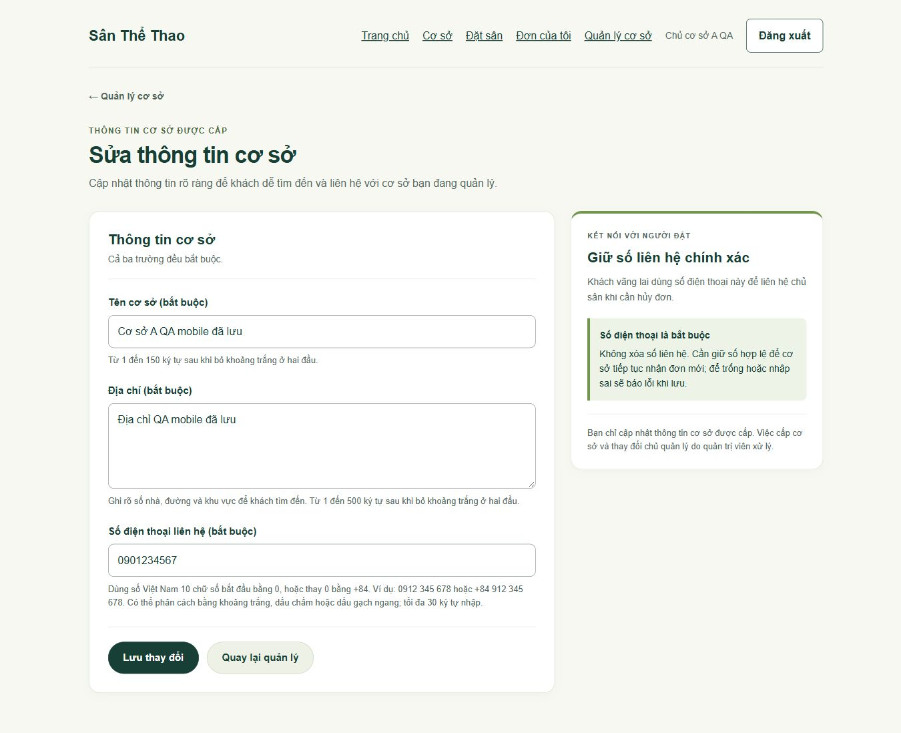
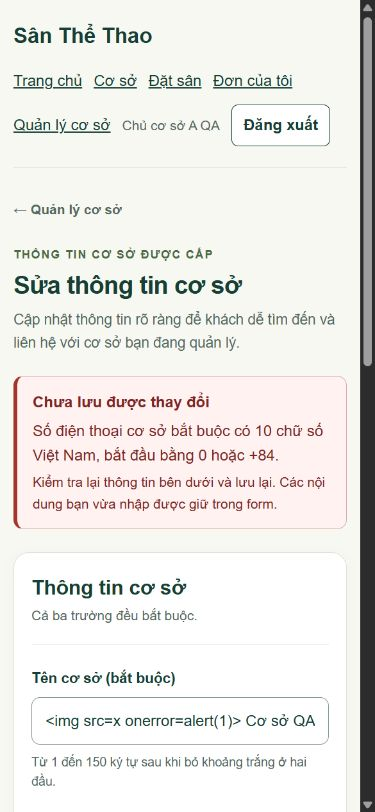

# UI sửa thông tin cơ sở — issue #40

Ngày kiểm tra: **24/10/2026 (UTC+7)**. Trình duyệt: **ChatGPT in-app browser (Chromium)**. Viewport: **390 × 844** và **1366 × 900**.

## Nền và phạm vi

- Base ứng dụng: `b704f6cbcfe53e4781f329d41170e6f44b8bd11c` trên `main`.
- Backend bàn giao: `84d21c3ea2426b744f98fd51cf05d09d846188da` của #9, đã được merge bằng PR #42, squash commit `15b8d58acda9bc3af78de8ea133f07a5471f30d8`.
- Chỉ đổi `views/owner-facility-form.ejs` và thêm `public/css/owner-facility-form.css`. CSS giới hạn trong `.owner-facility-page`; giữ các trang quản lý khác.
- Giữ `GET /owner/facilities/:id/edit`, `POST /owner/facilities/:id`, redirect 303 `/owner`, các input `name/address/phone/_csrf`, EJS escape, required, maxlength và autocomplete. Không thêm JS submit hoặc sửa backend/quyền.
- Git blob của đúng hai file UI đã kiểm tra được ghi trong [verification.json](verification.json); commit cuối cùng và kết quả CI được ghi ở PR.

## Dữ liệu và môi trường

MongoDB **8.3.11**, replica `qaOwner40` tại `127.0.0.1:27053`. Hai lượt browser dùng hai database `qa_owner40_*` độc lập. Có OWNER A/B đã duyệt, CUSTOMER, hai cơ sở, một sân và một đơn cũ CONFIRMED với hai SlotLock, một Payment mô phỏng. Tên, email `example.test`, địa chỉ và điện thoại đều là dữ liệu tổng hợp. Không đọc `.env`, không kết nối Atlas, không seed/migrate dữ liệu người dùng.

Lượt đầu chạy toàn bộ hành vi lưu/lỗi/bàn phím. Lượt hai chụp lại mobile bằng ảnh viewport vì chế độ chụp full-page làm đổi layout scrollbar và cắt mép ảnh. DOM thật ở viewport 390px có vùng nội dung 375px, `scrollWidth = clientWidth = 375`, các ô nằm trong vùng nội dung. Ở 1366px, hai giá trị đều là 1351px. Đây là scrollbar dọc; không dùng `overflow-x: hidden` để che lỗi.

Sau lượt chụp, tiến trình QA nền đã kết thúc trước bước dọn dữ liệu. Đã khởi động lại **cùng thư mục runtime**, không tạo lại fixture, đối chiếu dữ liệu đã lưu với baseline rồi xóa đúng DB có marker `issue40` và tắt MongoDB QA. [verification.json](verification.json) ghi riêng kết quả hai lượt. Court, User, đơn/lock/payment cũ và cơ sở B đều không đổi.

## Kết quả thực tế

| Ca | Bước và mong đợi | Thực tế | Bằng chứng |
| --- | --- | --- | --- |
| UI-01 | OWNER A đăng nhập, từ `/owner` mở **Sửa thông tin cơ sở**; form đúng cơ sở A | PASS: GET 200; tên/địa chỉ/SĐT của A; cả hai viewport | Ảnh thường, request log |
| UI-02 | Kiểm tra form và stylesheet; giữ contract thật | PASS: action chứa ID backend, POST, chỉ `_csrf/name/address/phone`, stylesheet tải 200, không script; cả hai viewport | `browser-results.json` |
| UI-03 | Xem trạng thái thường ở 390/1366 | PASS: mobile một cột/nút xếp dọc, desktop form + sidebar; không cuộn ngang, trường và nút đọc được | Ảnh thường và phần thao tác mobile |
| UI-04 | Nhập tên `…`, địa chỉ `…`, SĐT `090abc1234`; bấm lưu | PASS: POST 400, thông báo server rõ, cả ba giá trị giữ trong form; HTML là nội dung ô nhập, không có node img/script bị chèn; cả hai viewport | Ảnh lỗi, ảnh trường lỗi mobile, DOM và request log |
| UI-05 | Nhập tên 150 ký tự `N`, địa chỉ 500 ký tự `D` liền nhau, SĐT có dấu phân cách | PASS: textarea xuống dòng; input tên dùng cuộn nội bộ thông thường, không đẩy rộng trang; cả hai viewport | Ảnh dài, DOM geometry |
| UI-06 | Từ tên nhấn Tab → địa chỉ → Tab → điện thoại, Shift+Tab → địa chỉ | PASS: đúng thứ tự, outline solid thấy rõ; cả hai viewport | Ảnh focus, `browser-results.json` |
| UI-07 | Sửa dữ liệu hợp lệ, Enter trên nút lưu; mobile `+84 901.234-567`, desktop `+84 902.345-678` | PASS: POST 303 → `/owner`; tên/địa chỉ mới hiển thị, SĐT lần lượt `0901234567` và `0902345678` | Request log; trạng thái dashboard quan sát thực tế, desktop-save trong JSON |
| UI-08 | Bấm **Quay lại quản lý** ở desktop | PASS: về `/owner`; lối vào sửa vẫn hoạt động. Ở mobile, href `/owner` được kiểm tra trong DOM | Request log, markup |
| UI-09 | Mở **Cơ sở** sau lưu, kiểm tra ở cả hai viewport | PASS: hai card hiện đúng, có tên mới, không tràn ngang; không có form ghi hoặc link sửa trong nội dung công khai | `public-facilities-*` trong JSON, request log |

SĐT trong DOM automation được công cụ che nội dung. Giá trị `090abc1234` khi báo lỗi được kiểm tra trực tiếp trên ảnh; bộ test HTTP/MongoDB bên dưới kiểm tra tự động việc giữ dữ liệu và chuẩn hóa số. Không dùng dữ liệu DOM đã che để kết luận lỗi ứng dụng.

## Kiểm tra tự động

- `npm run check`: **PASS**, ESLint và cú pháp **17 template EJS**.
- `npm test`: **42/42 PASS**, không fail/skip/todo, chạy với `TEST_MONGODB_URI` trỏ replica localhost riêng.
- Trong đó suite OWNER cơ sở kiểm tra route/form/CSRF, quyền của các vai trò và chủ khác, ID sai/không tồn tại, validation/biên độ dài, giữ dữ liệu/escape, chuẩn hóa điện thoại, chống sửa owner/quyền/ID từ body, thu hồi/chuyển quyền và dữ liệu liên quan không đổi.
- `git diff --check`: PASS.

Để chạy lại test tự động, chuẩn bị MongoDB replica test cục bộ, đặt `TEST_MONGODB_URI` đến replica đó rồi chạy `npm run check` và `npm test`. Bộ test tạo/xóa database thử riêng. Để thử UI, dùng OWNER APPROVED có cơ sở được cấp và làm theo bảng trên; các tài khoản QA tạm của lần chạy này đã được dọn.

Các ca UI yêu cầu trong #40 đã chạy. Chưa kiểm tra Safari/Firefox, thiết bị điện thoại vật lý hoặc môi trường production; không suy kết quả lint thành kết quả chức năng. PR vẫn chờ nhóm trưởng review/merge.

## Ảnh giao diện

| Trạng thái | Mobile 390px | Desktop 1366px |
| --- | --- | --- |
| Thường | [Đầu form](390-normal.jpg), [trường SĐT và thao tác](390-normal-actions.jpg) | [Form đầy đủ](1366-normal.jpg) |
| Lỗi server | [Thông báo lỗi](390-error.jpg), [giữ giá trị và focus](390-error-fields.jpg) | [Form lỗi đầy đủ](1366-error.jpg) |
| Tên/địa chỉ dài | [Mobile](390-long.jpg) | [Desktop](1366-long.jpg) |
| Focus bàn phím | [Mobile](390-focus.jpg) | [Desktop](1366-focus.jpg) |

## Bằng chứng máy đọc được

- [browser-results.json](browser-results.json): DOM, viewport, focus, stylesheet và phép đo chống tràn.
- [browser-requests.jsonl](browser-requests.jsonl): method/path/status của request thật; không lưu body, cookie hoặc CSRF token.
- [verification.json](verification.json): nền SHA, blob UI, kết quả check/test và đối chiếu bản ghi được bảo vệ trước khi dọn DB tạm.
